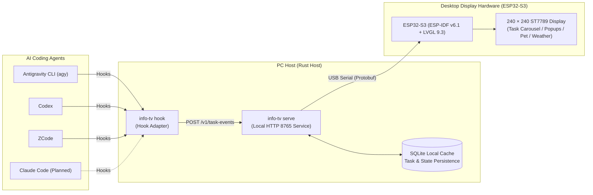
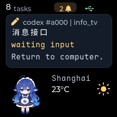
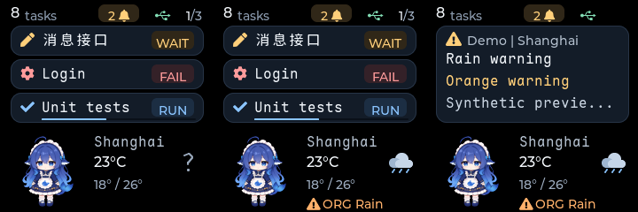
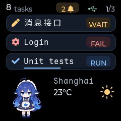

# ESP32 Info TV

A dedicated ESP32-S3 desktop secondary display / mini TV crafted for AI coding agents. Bring background agent task progress, permission prompts, and execution results directly to your physical desk, accompanied by a dynamic desktop pet and weather alert updates.

[English](README.md) · [中文文档](README_zh.md)

---

## Introduction

When using AI coding assistants (such as Antigravity CLI, Codex, ZCode, etc.), agents frequently execute long-running builds, tests, or reasoning tasks in the background, or pause at interactive checkpoints awaiting human permission approval.

**ESP32 Info TV** communicates with the host machine over USB serial to capture agent lifecycle events in real time and mirror terminal activity onto a compact desktop display:
- 🖥️ **Multi-Task Status Carousel**: Concurrently track multiple agent session cards showing running, awaiting approval, completed, or failed states. Multi-card paging automatically cycles (3 lines per page, smooth 6-second rotation).
- 🔔 **Instant Notification Popups**: Immediate popup alerts for critical events (such as permission confirmation or task completion), eliminating the need to constantly monitor console output.
- 🐳 **Dynamic Desktop Companion**: Integrated pixel deep-sea whale pet animation featuring natural random blinking and gravity-based swaying.
- ⛅ **Real-Time Weather & Weather Alerts**: Open-Meteo weather synchronization with high/low temperature ranges, weather condition icons, and sudden meteorological alert popups.
- ⚡ **Ultra-Lightweight Rust Host Service**: Runs as a standalone binary with minimal memory footprint—no Python or heavy runtime required. Built-in SQLite state persistence with automatic retry logic and Windows autostart support.
- 🔤 **Monospace CJK Typography**: Pre-bundled with Maple Mono NF CN, fully covering common CJK character sets and Nerd Font programming icons.

### Connection Topology



### Visual Showcase

| Task Overview Carousel | Notification Popup |
| :---: | :---: |
|  |  |

| Weather & Alert Display | Companion Animation |
| :---: | :---: |
|  |  |

---

## User Guide

This section is for users who want to run the prebuilt firmware and host service on an assembled device. **No ESP-IDF or Rust build environment is required**; simply download the release packages to get started.

### 1. Hardware Requirements

- **ESP32-S3 Development Board**: 16 MB Flash with a 240 × 240 ST7789 color LCD screen (the classic mini TV hardware; see [Hardware Reference](docs/hardware-reference.md) for pinouts and specs).
- **USB Type-C Cable**: Capable of data transmission (not charge-only).
- **PC** (Windows or Linux).

### 2. Download Prebuilt Releases

Visit the [GitHub Releases](https://github.com/ruicx/ESP32-Info-TV/releases) page and download two release assets for your OS:
1. **Rust Host Prebuilt Archive**:
   - Windows: e.g. `info-tv-<version>-x86_64-pc-windows-msvc.zip`
   - Linux: e.g. `info-tv-<version>-x86_64-unknown-linux-musl.tar.gz`
2. **Merged Firmware Binary**: e.g. `info-tv-firmware-<version>-esp32s3.bin`

Extract the archive into your preferred directory (optionally add it to your system `PATH`, or run directly from the folder):

```text
extracted-directory/
  ├── info-tv (info-tv.exe on Windows)  # Host core binary (background service, CLI, and hook adapters)
  ├── info-tv.yaml                      # Optional sample config (for weather coordinates, fixed serial port, etc.)
  └── firmware.bin                      # Downloaded firmware image (renamed here for convenient flashing)
```

> [!TIP]
> The release firmware is a merged binary containing the bootloader, partition table, and application image. It can be flashed in a single step starting at offset `0x0` without manual multi-segment flashing.

### 3. Flash ESP32 Firmware

If your board does not have the info_tv firmware flashed yet, you can write it using `esptool` (requires Python on your computer):

1. Install `esptool`:
   ```bash
   pip install esptool
   ```

2. Connect your ESP32-S3 and check for the serial port:
   ```bash
   info-tv ports
   ```
   > Note the port name (e.g., `COM6` on Windows, `/dev/ttyACM0` or `/dev/ttyUSB0` on Linux; the default ESP32-S3 USB VID:PID is `303A:1001`).

3. Flash the merged firmware image (replace `<port>` with your actual serial port):
   ```bash
   python -m esptool --chip esp32s3 --port <port> --baud 460800 write-flash 0x0 firmware.bin
   ```
   *If the transfer fails or times out, try lowering `--baud 460800` to `--baud 115200`.*

### 4. Start Host Service & Verify Display

> [!NOTE]
> The commands below use `info-tv`. If the directory is not in your `PATH`, use `.\info-tv.exe` on Windows or `./info-tv` on Linux.

1. Start the service in your first terminal:
   ```bash
   info-tv serve
   ```
   *The service automatically scans and connects to a matching ESP32-S3 screen. If multiple serial devices are plugged in, specify `--serial-port <port>` manually.*

2. In a second terminal, verify connectivity and send test cards:
   ```bash
   # Check service and screen connection status
   info-tv status

   # Submit a test task card and mark it completed
   info-tv task submit --task-id test-run-1 --sequence 1 --state running --title "Test Task"
   info-tv task submit --task-id test-run-1 --sequence 2 --state completed --title "Test Task Completed"

   # List active task cards
   info-tv task list
   ```
   The display should immediately turn on, showing the task card and completion popup notification.

3. **Set Up Autostart (Optional, Windows only)**:
   ```bash
   # Register login autostart service
   info-tv autostart install --config info-tv.yaml
   ```

---

### 5. Configure Agent Hooks

Hooks allow AI coding agents to trigger shell commands automatically during lifecycle events (receiving prompts, calling tools, requesting permissions, stopping tasks, etc.).

> [!TIP]
> Hook commands invoke `info-tv hook <source>`. Replace `<full-path-to-info-tv>` in the examples below with the **actual absolute path** to your executable (e.g., `/usr/local/bin/info-tv` on Linux, or forward-slash paths like `D:/tools/info-tv/info-tv.exe` on Windows).

#### ZCode

Edit `~/.zcode/cli/config.json` (`%USERPROFILE%\.zcode\cli\config.json` on Windows, encoded as UTF-8) and merge the `hooks` configuration into the JSON object:

```json
{
  "hooks": {
    "enabled": true,
    "events": {
      "UserPromptSubmit": [
        {"hooks": [{"type": "process", "command": "<full-path-to-info-tv>", "args": ["hook", "zcode"], "timeoutMs": 3000}]}
      ],
      "PreToolUse": [
        {"hooks": [{"type": "process", "command": "<full-path-to-info-tv>", "args": ["hook", "zcode"], "timeoutMs": 3000}]}
      ],
      "PermissionRequest": [
        {"hooks": [{"type": "process", "command": "<full-path-to-info-tv>", "args": ["hook", "zcode"], "timeoutMs": 3000}]}
      ],
      "PostToolUse": [
        {"hooks": [{"type": "process", "command": "<full-path-to-info-tv>", "args": ["hook", "zcode"], "timeoutMs": 3000}]}
      ],
      "PostToolUseFailure": [
        {"hooks": [{"type": "process", "command": "<full-path-to-info-tv>", "args": ["hook", "zcode"], "timeoutMs": 3000}]}
      ],
      "Stop": [
        {"hooks": [{"type": "process", "command": "<full-path-to-info-tv>", "args": ["hook", "zcode"], "timeoutMs": 3000}]}
      ]
    }
  }
}
```

> [!NOTE]
> After saving the ZCode configuration, start a **new session** for the hooks to take effect.

#### Codex

Edit `~/.codex/hooks.json` (`%USERPROFILE%\.codex\hooks.json` on Windows, or check `$CODEX_HOME` if customized) and add the following event handlers:

```json
{
  "hooks": {
    "UserPromptSubmit": [
      {"hooks": [{"type": "command", "command": "<full-path-to-info-tv> hook codex", "timeout": 3}]}
    ],
    "PreToolUse": [
      {"hooks": [{"type": "command", "command": "<full-path-to-info-tv> hook codex", "timeout": 3}]}
    ],
    "PermissionRequest": [
      {"hooks": [{"type": "command", "command": "<full-path-to-info-tv> hook codex", "timeout": 3}]}
    ],
    "PostToolUse": [
      {"hooks": [{"type": "command", "command": "<full-path-to-info-tv> hook codex", "timeout": 3}]}
    ],
    "Stop": [
      {"hooks": [{"type": "command", "command": "<full-path-to-info-tv> hook codex", "timeout": 3}]}
    ],
    "Interrupt": [
      {"hooks": [{"type": "command", "command": "<full-path-to-info-tv> hook codex", "timeout": 3}]}
    ]
  }
}
```

> [!IMPORTANT]
> After saving, run **`/hooks`** inside Codex (or navigate to **Settings > Hooks** in the desktop client) to review and **trust** the info-tv hooks. Codex ignores untrusted hooks until approved.

#### Antigravity CLI (`agy`)

Create or edit `.agents/hooks.json` in the root of any workspace you want to monitor (or write globally to `~/.gemini/config/hooks.json`, `%USERPROFILE%\.gemini\config\hooks.json` on Windows):

```json
{
  "info-tv": {
    "PreInvocation": [
      {"type": "command", "command": "<full-path-to-info-tv> hook agy PreInvocation", "timeout": 3}
    ],
    "PreToolUse": [
      {
        "matcher": "*",
        "hooks": [
          {"type": "command", "command": "<full-path-to-info-tv> hook agy PreToolUse", "timeout": 3}
        ]
      }
    ],
    "PostToolUse": [
      {
        "matcher": "*",
        "hooks": [
          {"type": "command", "command": "<full-path-to-info-tv> hook agy PostToolUse", "timeout": 3}
        ]
      }
    ],
    "Stop": [
      {"type": "command", "command": "<full-path-to-info-tv> hook agy Stop", "timeout": 3}
    ]
  }
}
```

Run `/hooks` in agy to confirm that hooks are loaded successfully.

#### Claude Code

> [!NOTE]
> Support is currently in progress (TODO); a dedicated hook adapter will be provided in an upcoming release.

---

### 6. Troubleshooting (FAQ)

| Issue | Resolution |
| --- | --- |
| `python` or `pip` is not recognized | Ensure Python is installed and added to your system `PATH`. Running the host service after flashing does not require any Python installation. |
| Firmware flashing times out | Check for low-power USB hubs or charge-only cables; make sure no other terminal or host service is holding the serial port open. If flashing still fails, hold the BOOT button, press the RESET button once, and retry in download mode. |
| Serial port permission denied on Linux | Accessing serial devices requires appropriate user permissions; run `sudo usermod -aG dialout $USER` (or `uucp` depending on the distro) and log back in. |
| Host status shows `offline` | Run `info-tv ports` to check whether the port changed. If multiple serial devices are connected, explicitly specify `--serial-port <port>`. Ensure the firmware and host versions match. |
| Black screen / no backlight | Check USB power supply. While the host is `online`, run `info-tv brightness 50` to adjust display brightness. |
| Manual CLI submissions work, but Agent does not push updates | Verify that the absolute executable path in `hooks.json` is correct. Codex users must approve hooks via `/hooks`. ZCode users must verify `hooks.enabled: true` and start a new session. |

---

## Development Guide

### Project Structure

```text
info_tv/
├── host/           # Rust host service: task state manager, SQLite cache, USB serial driver, HTTP API, CLI & hooks
├── firmware/       # ESP32-S3 firmware: ESP-IDF v6.1, FreeRTOS, C++, LVGL 9.3 & ST7789 display driver
├── protocol/       # Communication protocol definitions: Protobuf schemas and Nanopb configuration
├── scripts/        # Utility scripts: Host/firmware build & packaging scripts, protocol generation, font converter, etc.
├── demos/          # Demonstration scripts: Python examples submitting simulated task progress to HTTP API
└── docs/           # Architecture documents, protocol details, hardware references, and design notes
```

### Host Service Build

Prerequisites:
- Rust 1.89+ (with cargo)
- Local C/C++ build toolchain (for compiling the embedded SQLite driver)

Run from the repository root:

**Windows (PowerShell)**:

```powershell
# Build Release executable (output to host/target/release/)
./scripts/host/build_host.ps1

# (Optional) Build Debug executable
./scripts/host/build_host.ps1 -Debug

# Package Release distribution archive (output to build/host-dist/)
./scripts/host/build_host_release.ps1
```

**Linux / macOS (Bash)**:

```bash
# Build Release executable (output to host/target/release/)
bash scripts/host/build_host.sh

# (Optional) Build Debug executable
bash scripts/host/build_host.sh --debug

# Package Release distribution archive (output to build/host-dist/)
bash scripts/host/build_host_release.sh
```

**Development & Testing (Cross-Platform)**:

```bash
# Run host service directly
cargo run --manifest-path host/Cargo.toml --locked -- serve

# Run with custom configuration (e.g. enabling weather sync)
cargo run --manifest-path host/Cargo.toml --locked -- serve --config info-tv.yaml

# Code formatting, linting, and tests
cargo fmt --manifest-path host/Cargo.toml -- --check
cargo clippy --manifest-path host/Cargo.toml --all-targets --locked -- -D warnings
cargo test --manifest-path host/Cargo.toml --locked
```

### ESP32 Firmware Build

Prerequisites:
- Activated **ESP-IDF v6.1** shell environment (`idf.py`)

Run from the repository root:

**Windows (PowerShell)**:

```powershell
# Build firmware (output to firmware/build/)
./scripts/firmware/build_firmware.ps1

# Build and flash to device (stop host service first to free serial port, replace COM6 with actual port)
./scripts/firmware/build_firmware.ps1 -Action Flash -Port COM6

# Package Release merged firmware binary (output to build/firmware-dist/)
./scripts/firmware/build_firmware_release.ps1
```

**Linux (Bash)**:

```bash
# Build firmware (output to firmware/build/)
bash scripts/firmware/build_firmware.sh

# Build and flash to device (replace /dev/ttyACM0 with actual port)
bash scripts/firmware/build_firmware.sh --action flash --port /dev/ttyACM0

# Package Release merged firmware binary (output to build/firmware-dist/)
bash scripts/firmware/build_firmware_release.sh
```

**Direct idf.py Commands (Cross-Platform)**:

```bash
# Build firmware (IDF Component Manager automatically pulls locked LVGL 9.3 dependency)
idf.py -C firmware build

# Flash to connected ESP32-S3
idf.py -C firmware -p <port> flash
```

### Protocol Code Generation

When modifying `.proto` protocol definitions under `protocol/`, regenerate Nanopb C bindings with a single command (Cargo automatically regenerates Rust bindings during host compilation):

```bash
uv sync --project scripts --locked
uv run --project scripts --locked python scripts/protocol/generate_protocol.py
```

### Custom Font Generation

The firmware bundles the open-source **Maple Mono NF CN Regular v7.9** font in 16 px, 4 bpp format, mapped into Flash without occupying precious internal RAM.

To regenerate or replace font assets, run the maintenance script from the repository root (requires Node.js and npm):

```bash
python scripts/firmware/generate_font.py
```

The script automatically downloads the upstream font file, verifies its SHA-256 checksum, and invokes `lv_font_conv` to generate `firmware/main/ui/fonts/font_maple_mono_16.c`. See [Font Conversion Documentation](docs/font-conversion.md) for details.

### Character Asset Generation

Companion animation frames displayed on the screen are automatically cropped from original sprite sheets, proportionally scaled, and converted to LVGL C source arrays:

```bash
uv run --project scripts python scripts/characters/prepare_whale.py
```

The script fetches the official sprite sheet from upstream, verifies its SHA-256 checksum, and generates unified 80 × 84 `.png` previews alongside C source arrays in `firmware/main/ui/assets/`. See [Character Asset Reference](firmware/main/ui/assets/README.md) for details.

---

## Acknowledgments

- Character Animation Assets: [YunYueSama / codex-deepseek-pet](https://github.com/YunYueSama/codex-deepseek-pet) (cropped and adapted under its open-source license).
- Font Assets: [subframe7536 / maple-font](https://github.com/subframe7536/maple-font) (licensed under SIL Open Font License 1.1).

---

## License

This project is open-source under the [MIT License](LICENSE) (refer to the LICENSE file in the repository).
