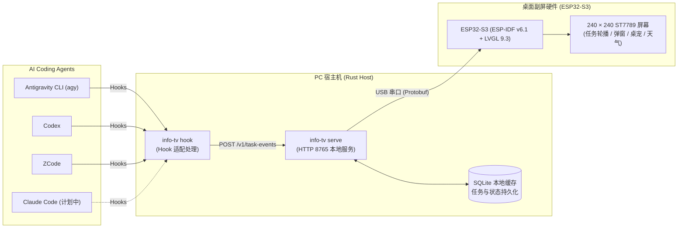
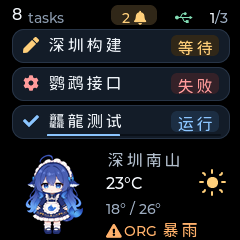
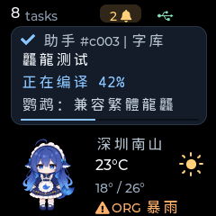
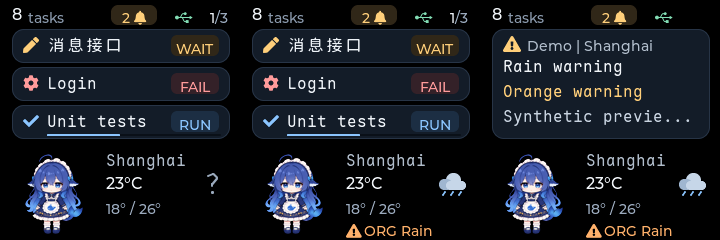
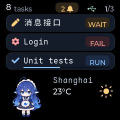

# ESP32 Info TV

专为 AI Coding Agent 打造的 ESP32-S3 桌面副屏 / 桌搭小电视。将后台默默运行的 Agent 任务进度、审批提示、运行结果直观呈现在桌面上，兼具桌面小宠与天气预警功能。

[English](README.md) · [中文文档](README_zh.md)

---

## 简介

在日常使用 AI 编程助手（如 Antigravity CLI、Codex、ZCode 等）时，Agent 经常需要在后台执行长时间的编译、测试或推理任务，或是停在等待权限审批（Permission Request）的交互点。

**ESP32 Info TV** 通过 USB 串口与宿主机通信，实时捕获 Agent 生命周期事件，将终端中的信息投递到小巧的桌面屏幕上：
- 🖥️ **Agent 多任务状态轮播**：支持同时跟踪多个 Agent 会话卡片，实时显示运行中、等待交互、已完成、失败等状态；多卡片自动分页轮播（每页 3 行，每 6 秒平滑滚动）。
- 🔔 **弹窗气泡即时提醒**：关键节点（如需要权限确认、任务结束）即刻弹窗提醒，无需时刻紧盯控制台输出。
- 🐳 **灵动桌宠陪伴**：集成可爱的深海小鲸鱼像素桌宠动画，支持自然的随机眨眼与重力晃动效果。
- ⛅ **实时天气与灾害预警**：支持 Open-Meteo 天气同步、高低温区间、天气图标以及突发气象预警弹窗。
- ⚡ **极速无感宿主服务（Rust）**：独立二进制运行，内存占用极低，无需安装 Python 等重型运行时环境；内置 SQLite 状态持久化与自动重试机制；支持 Windows 开机自启。
- 🔤 **优雅的单色中文排版**：预置 Maple Mono NF CN（枫叶单色中文字体），完整覆盖常用 CJK 字符集与 Nerd Font 编程图标。

### 连接拓扑



### 效果展示

| 任务概览轮播 | 弹窗通知 |
| :---: | :---: |
|  |  |

| 天气与预警显示 | 桌宠动画效果 |
| :---: | :---: |
|  |  |

---

## 使用指南

本节面向想要直接使用成品屏幕的用户。**无需配置 ESP-IDF 或 Rust 编译环境**，只需下载 Release 预编译包即可完成部署。

### 1. 硬件准备

- **ESP32-S3 开发板**：16 MB Flash、带 240 × 240 ST7789 彩色 LCD 屏幕（即经典的小电视硬件，详见 [硬件参考说明](docs/hardware-reference.md)）。
- **Type-C 数据线**：支持数据传输（避免仅充电线）。
- **电脑**（Windows 或 Linux）。

### 2. 下载发布产物

前往 [GitHub Releases](https://github.com/ruicx/ESP32-Info-TV/releases) 页面，下载对应系统的两个核心产物：
1. **Rust Host 预编译压缩包**：
   - Windows: 如 `info-tv-<version>-x86_64-pc-windows-msvc.zip`
   - Linux: 如 `info-tv-<version>-x86_64-unknown-linux-musl.tar.gz`
2. **完整固件镜像**：如 `info-tv-firmware-<version>-esp32s3.bin`

解压至您常用的任意本地目录（建议可将解压目录加入系统环境变量 PATH，或直接在目录内运行）：

```text
解压目录/
  ├── info-tv (Windows 下为 info-tv.exe)  # Host 核心程序（内置后台服务、CLI 工具与 Hook 适配功能）
  ├── info-tv.yaml                         # 示例配置文件（可选，用于配置天气坐标或固定串口等）
  └── firmware.bin                         # 下载的固件镜像（重命名放置于此，便于后续烧录）
```

> [!TIP]
> 固件镜像为已打包引导加载程序（Bootloader）、分区表与应用程序的单一合并文件（Merged Binary），从 `0x0` 偏移量一次性烧录即可，无需手动分段刷写。

### 3. ESP32 固件刷写

如果板子上尚未刷入 info_tv 固件，可直接使用 `esptool` 工具烧录（需电脑具备 Python 环境）：

1. 安装 `esptool`：
   ```bash
   pip install esptool
   ```

2. 插入 ESP32-S3，在终端中查询串口设备：
   ```bash
   info-tv ports
   ```
   > 记下对应的串口号（Windows 下如 `COM6`，Linux 下如 `/dev/ttyACM0` 或 `/dev/ttyUSB0`；ESP32-S3 默认 VID:PID 为 `303A:1001`）。

3. 烧录完整固件镜像（将下面的 `<串口号>` 替换为您实际的端口，例如 `COM6` 或 `/dev/ttyACM0`）：
   ```bash
   python -m esptool --chip esp32s3 --port <串口号> --baud 460800 write-flash 0x0 firmware.bin
   ```
   *如遇到写入不稳定，可将 `--baud 460800` 降低为 `--baud 115200` 重试。*

### 4. 启动 Host 服务并校验屏幕

> [!NOTE]
> 示例命令直接使用 `info-tv`。若未配置环境变量 PATH，在当前目录下运行时 Windows 可输入 `.\info-tv.exe`，Linux 可输入 `./info-tv`。

1. 在第一个终端窗口中启动服务端：
   ```bash
   info-tv serve
   ```
   *服务将自动扫描并连接匹配的 ESP32-S3 屏幕。若连接了多个设备，可通过 `--serial-port <串口号>` 手动指定。*

2. 打开第二个终端窗口，测试状态与卡片发送：
   ```bash
   # 检查服务与屏幕连接状态
   info-tv status

   # 发送一条测试任务卡片并标记完成
   info-tv task submit --task-id test-run-1 --sequence 1 --state running --title "测试任务"
   info-tv task submit --task-id test-run-1 --sequence 2 --state completed --title "测试任务已完成"

   # 查看当前卡片列表
   info-tv task list
   ```
   此时屏幕应立刻亮起，呈现对应任务卡片及完成通知弹窗。

3. **设置开机自启（可选，Windows 支持）**：
   ```bash
   # 注册登录自启动服务
   info-tv autostart install --config info-tv.yaml
   ```

---

### 5. 配置 Agent Hooks

Hook 是各 Agent 在执行特定生命周期事件（接收提示词、调用工具、请求授权、任务终止等）时自动调用的脚本钩子。

> [!TIP]
> Hook 命令直接调用 `info-tv hook <source>`。请将下文配置中的 `<info-tv 完整路径>` 替换为您本地 `info-tv` 可执行程序的**实际绝对路径**（例如 Linux 下 `/usr/local/bin/info-tv`，Windows 下推荐使用正斜杠路径如 `D:/tools/info-tv/info-tv.exe`）。

#### ZCode

编辑 `~/.zcode/cli/config.json`（Windows 下为 `%USERPROFILE%\.zcode\cli\config.json`，确保为 UTF-8 编码），将 `hooks` 配置合并到 JSON 中：

```json
{
  "hooks": {
    "enabled": true,
    "events": {
      "UserPromptSubmit": [
        {"hooks": [{"type": "process", "command": "<info-tv 完整路径>", "args": ["hook", "zcode"], "timeoutMs": 3000}]}
      ],
      "PreToolUse": [
        {"hooks": [{"type": "process", "command": "<info-tv 完整路径>", "args": ["hook", "zcode"], "timeoutMs": 3000}]}
      ],
      "PermissionRequest": [
        {"hooks": [{"type": "process", "command": "<info-tv 完整路径>", "args": ["hook", "zcode"], "timeoutMs": 3000}]}
      ],
      "PostToolUse": [
        {"hooks": [{"type": "process", "command": "<info-tv 完整路径>", "args": ["hook", "zcode"], "timeoutMs": 3000}]}
      ],
      "PostToolUseFailure": [
        {"hooks": [{"type": "process", "command": "<info-tv 完整路径>", "args": ["hook", "zcode"], "timeoutMs": 3000}]}
      ],
      "Stop": [
        {"hooks": [{"type": "process", "command": "<info-tv 完整路径>", "args": ["hook", "zcode"], "timeoutMs": 3000}]}
      ]
    }
  }
}
```

> [!NOTE]
> ZCode 配置完成后，需**新建一个会话**使其生效。

#### Codex

编辑 `~/.codex/hooks.json`（Windows 下为 `%USERPROFILE%\.codex\hooks.json`，若设置了 `CODEX_HOME` 则对应修改），添加以下事件处理：

```json
{
  "hooks": {
    "UserPromptSubmit": [
      {"hooks": [{"type": "command", "command": "<info-tv 完整路径> hook codex", "timeout": 3}]}
    ],
    "PreToolUse": [
      {"hooks": [{"type": "command", "command": "<info-tv 完整路径> hook codex", "timeout": 3}]}
    ],
    "PermissionRequest": [
      {"hooks": [{"type": "command", "command": "<info-tv 完整路径> hook codex", "timeout": 3}]}
    ],
    "PostToolUse": [
      {"hooks": [{"type": "command", "command": "<info-tv 完整路径> hook codex", "timeout": 3}]}
    ],
    "Stop": [
      {"hooks": [{"type": "command", "command": "<info-tv 完整路径> hook codex", "timeout": 3}]}
    ],
    "Interrupt": [
      {"hooks": [{"type": "command", "command": "<info-tv 完整路径> hook codex", "timeout": 3}]}
    ]
  }
}
```

> [!IMPORTANT]
> 修改保存后，在 Codex 中输入 **`/hooks`**（或在桌面客户端的 **设置 > Hooks**），审查并**信任** info-tv 钩子；未信任前 Codex 将忽略这些钩子。

#### Antigravity CLI (`agy`)

在需要监控的项目根目录下创建或编辑 `.agents/hooks.json`（如需全局生效，可写入 `~/.gemini/config/hooks.json`，Windows 下为 `%USERPROFILE%\.gemini\config\hooks.json`）：

```json
{
  "info-tv": {
    "PreInvocation": [
      {"type": "command", "command": "<info-tv 完整路径> hook agy PreInvocation", "timeout": 3}
    ],
    "PreToolUse": [
      {
        "matcher": "*",
        "hooks": [
          {"type": "command", "command": "<info-tv 完整路径> hook agy PreToolUse", "timeout": 3}
        ]
      }
    ],
    "PostToolUse": [
      {
        "matcher": "*",
        "hooks": [
          {"type": "command", "command": "<info-tv 完整路径> hook agy PostToolUse", "timeout": 3}
        ]
      }
    ],
    "Stop": [
      {"type": "command", "command": "<info-tv 完整路径> hook agy Stop", "timeout": 3}
    ]
  }
}
```

在 agy 中运行 `/hooks` 即可检查钩子是否成功加载。

#### Claude Code

> [!NOTE]
> 正在适配中（TODO），后续版本将提供专属 Hook 适配器支持。

---

### 6. 常见问题排查 (FAQ)

| 现象 | 排查方法 |
| --- | --- |
| 无法识别 `python` 或 `pip` | 请确保系统已安装 Python 并已将其添加至系统环境变量 PATH；烧录完毕后 Host 运行不需要任何 Python 环境。 |
| 固件烧录提示连接超时 | 检查是否使用了供电不足的 USB 接口或纯充电线；烧录前确保关闭了任何正在占用串口的终端或 Host 进程；若依旧失败，按住开发板 BOOT 键再按一下 RESET 键进入下载模式后重试。 |
| Linux 下串口提示权限不足 | Linux 下访问串口需对应用户组权限，可运行 `sudo usermod -aG dialout $USER`（某些发行版为 `uucp`），重新登录后生效。 |
| Host 显示 `offline` 离线 | 重新执行 `info-tv ports` 查看端口是否改变；如存在多个串口设备，请使用 `--serial-port <串口号>` 显式指定；确认固件版本与 Host 版本一致。 |
| 屏幕黑屏没有背光 | 检查 USB 供电；在 Host 处于 online 状态下执行 `info-tv brightness 50` 调节亮度。 |
| 手动提交卡片生效，但 Agent 不推送 | 检查 `hooks.json` 中配置的绝对路径是否正确；Codex 用户请确认是否已执行 `/hooks` 授权信任；ZCode 用户需确认 `hooks.enabled: true` 并开启了新会话。 |

---

## 开发指南

### 代码结构

```text
info_tv/
├── host/           # Rust 服务端工程：任务状态管理、SQLite 缓存、USB 串口驱动、HTTP API、CLI 与 Hooks
├── firmware/       # ESP32-S3 固件工程：基于 ESP-IDF v6.1、FreeRTOS、C++、LVGL 9.3 与 ST7789 驱动
├── protocol/       # 通信协议定义：Protobuf 结构体与 Nanopb 配置文件
├── scripts/        # 工具脚本：Host 与固件编译打包发布脚本、协议代码生成、字体转换等
├── demos/          # 演示脚本：用于向 HTTP API 提交模拟任务进度的 Python 示例
└── docs/           # 架构文档、协议细节、硬件参考以及设计说明
```

### Host 服务端编译

要求环境：
- Rust 1.89+ (带有 cargo)
- 本地 C/C++ 构建工具（用于编译内置的 SQLite 驱动）

在仓库根目录下运行：

**Windows (PowerShell)**：

```powershell
# 编译 Release 版可执行程序（输出至 host/target/release/）
./scripts/host/build_host.ps1

# （可选）编译 Debug 版
./scripts/host/build_host.ps1 -Debug

# 打包发布版完整归档（输出至 build/host-dist/）
./scripts/host/build_host_release.ps1
```

**Linux / macOS (Bash)**：

```bash
# 编译 Release 版可执行程序（输出至 host/target/release/）
bash scripts/host/build_host.sh

# （可选）编译 Debug 版
bash scripts/host/build_host.sh --debug

# 打包发布版完整归档（输出至 build/host-dist/）
bash scripts/host/build_host_release.sh
```

**开发调试与测试（跨平台）**：

```bash
# 直接运行服务
cargo run --manifest-path host/Cargo.toml --locked -- serve

# 启动带有配置文件的服务（例如开启天气同步功能）
cargo run --manifest-path host/Cargo.toml --locked -- serve --config info-tv.yaml

# 代码格式化与测试
cargo fmt --manifest-path host/Cargo.toml -- --check
cargo clippy --manifest-path host/Cargo.toml --all-targets --locked -- -D warnings
cargo test --manifest-path host/Cargo.toml --locked
```

在 Windows 上，在 `info-tv.yaml` 中设置 `lock_action: deep_sleep` 并重启主机服务，
即可在当前 Windows 会话锁屏时让 ESP32 深度休眠。触摸顶部可唤醒；电脑仍锁屏时，
画面显示 15 秒后再次休眠，期间解锁则保持运行。增加 `unlock_poll_seconds: 5`
可自动检查解锁：每次休眠 5 秒后重连 USB，仍锁屏则保持黑屏并再次休眠。
该配置默认 `0`，表示禁用自动检查；解锁恢复还需加上启动和 USB 重连时间。
主机与固件需一起更新。锁屏动作默认值为 `none`；`screen_off` 仅关闭背光并保持 USB 连接。
详见 [YAML 配置说明](docs/host-configuration.md#follow-windows-session-locking)。

### ESP32 固件编译

要求环境：
- 已激活的 **ESP-IDF v6.1** 终端环境（使用 `idf.py`）

在仓库根目录下运行：

**Windows (PowerShell)**：

```powershell
# 编译固件（输出至 firmware/build/）
./scripts/firmware/build_firmware.ps1

# 编译并烧录至设备（注意先停止 Host 服务以释放串口，替换 COM6 为实际串口号）
./scripts/firmware/build_firmware.ps1 -Action Flash -Port COM6

# 打包发布版合并固件（输出至 build/firmware-dist/）
./scripts/firmware/build_firmware_release.ps1
```

**Linux (Bash)**：

```bash
# 编译固件（输出至 firmware/build/）
bash scripts/firmware/build_firmware.sh

# 编译并烧录至设备（替换 /dev/ttyACM0 为实际串口号）
bash scripts/firmware/build_firmware.sh --action flash --port /dev/ttyACM0

# 打包发布版合并固件（输出至 build/firmware-dist/）
bash scripts/firmware/build_firmware_release.sh
```

**原生 idf.py 命令（跨平台）**：

```bash
# 编译固件（组件管理器会自动拉取锁定的 LVGL 9.3 依赖）
idf.py -C firmware build

# 烧录到连接的 ESP32-S3
idf.py -C firmware -p <串口号> flash
```

### 协议代码生成

当修改了 `protocol/` 下的 `.proto` 协议文件后，可通过脚本一键生成 Nanopb C 绑定代码（Cargo 会在编译 host 时自动重新生成 Rust 绑定）：

```bash
uv sync --project scripts --locked
uv run --project scripts --locked python scripts/protocol/generate_protocol.py
```

### 自定义字体制作

固件集成了开源的 **Maple Mono NF CN Regular v7.9** 字体，采用 16 px、4 bpp 格式，完整映射存储在 Flash 中，无需占用宝贵的内部 RAM。

若需要重新生成或替换字体资源，可在仓库根目录下执行维护脚本（需要本地安装 Node.js 与 npm）：

```bash
python scripts/firmware/generate_font.py
```

脚本将自动拉取官方字体文件，校验 SHA-256，调用 `lv_font_conv` 工具转换生成 `firmware/main/ui/fonts/font_maple_mono_16.c`。详细细节请参阅 [字体转换文档](docs/font-conversion.md)。


### 卡通素材制作

屏幕显示的伴侣动画角色帧可通过专属脚本从原图精灵表中自动裁剪、等比缩放并转换为 LVGL C 源码：

```bash
uv run --project scripts python scripts/characters/prepare_whale.py
```

脚本将自动从上游开源项目拉取官方立绘精灵表、校验 SHA-256，生成 80 × 84 统一画幅的 `.png` 预览图与 `firmware/main/ui/assets/` 下的 C 源码数组。详细说明请参阅 [角色素材说明](firmware/main/ui/assets/README.md)。

---

## 鸣谢与致谢

- 动画角色素材来源：[YunYueSama / codex-deepseek-pet](https://github.com/YunYueSama/codex-deepseek-pet)（遵循其开源许可协议进行了裁剪与适配）。
- 字体素材：[subframe7536 / maple-font](https://github.com/subframe7536/maple-font)（遵循 SIL Open Font License 1.1）。

---

## 许可证

本项目基于 [MIT 许可证](LICENSE) 开源（以仓库 LICENSE 文件为准）。
