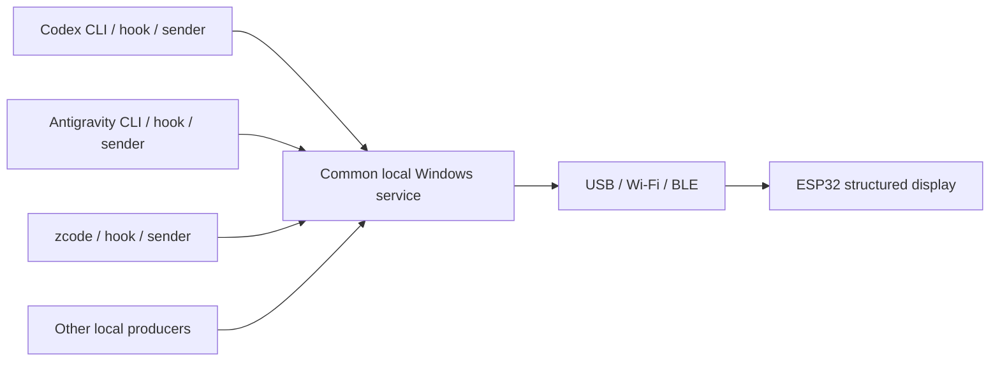
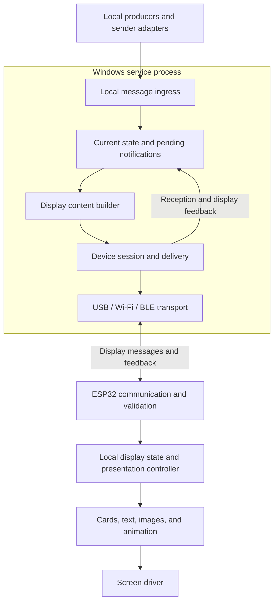

# Software Architecture

Status: Minimal host/firmware USB implementation built, tested, and validated on the board. Remaining product capabilities and performance tuning are pending.

Updated: 2026-11-03

The host is being replaced by Rust. The accepted direction and implementation
boundaries are in [Rust host design](rust-host-design.md), including restart
recovery and per-user login startup. Python/FastAPI choices below describe the
original implementation and remain useful migration context.

The implemented baseline is described in [Minimal Demo Implementation](demo-implementation.md) and the current [Device Protocol](device-protocol.md). The host is now organized under `host/`: Python core code is portable, with Windows tested first. Earlier references to Windows describe the initial deployment context. Proposed sections below retain the broader product design; the implementation document takes precedence for concrete demo choices.

[Hardware Validation](hardware-validation.md) records the successful first flash, actual USB/display feedback, user visual confirmation, and powered serial-recovery test.

## 1. Related Documents

- [Requirements Analysis](requirements.md): confirmed user-visible behavior, scope, and acceptance scenarios.
- [Hardware Reference](hardware-reference.md): board configuration, diagnostic results, and remaining hardware validation.

The user confirmed the overall framework on 2026-11-03: one Windows service process plus ESP32 firmware, internal Windows modules, separate producer and device message contracts, and Windows-owned business state with device-owned presentation. The user subsequently selected Python/FastAPI for Windows and ESP-IDF/FreeRTOS, C++, LVGL, and esp_lcd/ST7789 for the ESP32, with communication and UI as its initial application tasks. Sections marked Proposed remain recommendations rather than accepted implementation choices. Supporting integration details, versions, protocols, and the detailed message schema have not been finalized.

## 2. Confirmed Message Flow

Codex CLI, Antigravity CLI, zcode, and other local producers submit messages to a common Windows service process. That process handles downstream delivery to the ESP32, which renders structured content.



Producers connect only to the local service. They do not manage the ESP32 address, port, or active transport. Changing the downstream transport leaves the producer-facing interface unchanged.

The named products are intended integration targets. This does not establish that each exposes compatible native hooks. Source-specific event capture may require a hook or sender adapter and remains outside the common service core. The service does not need to launch agents, monitor their consoles, or parse private transcripts to receive a submitted message.

## 3. Responsibility Boundaries

Message handling, current-state ownership, display content generation, downstream communication, and local presentation responsibilities are confirmed at the module level. Asset preparation, storage, and transfer details remain proposed.

| Responsibility | Producer or sender adapter | Windows service | ESP32 display terminal |
| --- | --- | --- | --- |
| Source events | Capture relevant events and submit messages through the common local interface | Receive and validate submitted messages | Receive unified display content |
| Content preparation | Adapt source-specific events to the agreed input fields | Prepare the device display representation | Handle text and display fields according to the agreed model |
| Display scheduling | Supply message content and agreed metadata | Determine priority, merging, and delivery timing | Execute local playback, timing, and page restoration |
| Data state | Identify the task or object represented by a message | Maintain current accepted content and necessary caches | Keep the limited state needed for display |
| Assets | Submit or reference supported assets as defined later | Prepare and distribute assets as defined later | Cache and play supported assets |
| Connectivity | Connect only to the local service | Manage ESP32 connections, delivery, and recovery synchronization | Report connection and reception status |

Producer adapters may be supplied by this project. Whether calendar and weather retrieval run as separate senders or as Windows-side modules remains open; their output enters the same message flow.

Source independence avoids coupling the device to calendar, weather, or agent business protocols. The device still understands display types, fields, validity, and local interaction rules.

## 4. Confirmed Process and Module Structure

Use one Windows service process with internal modules, plus the ESP32 firmware. The modules below do not imply separate processes or independently deployed services.



| Windows module | Confirmed responsibility |
| --- | --- |
| Local ingress | Receive local submissions, validate supported input, and report acceptance or rejection |
| Current state and pending notifications | Keep independent task state, coalesce progress, track duplicate events, and retain pending notifications according to the eventual policy |
| Display content builder | Convert accepted information into source-independent overview content and notification cards |
| Device session and delivery | Track the connected device, synchronize current content, deliver pending messages, and distinguish reception from display feedback |
| Transport | Implement connection and message framing for USB, Wi-Fi, or BLE without changing producer behavior |

State storage can initially be designed around the data needed for current operation. Whether it persists across service restarts is deferred for prototype evaluation; do not promise durable acceptance until that policy and implementation exist.

## 5. Confirmed Message Boundaries

Keep two contracts with different purposes:

1. **Producer to service:** describe the event or current information, such as a task waiting for input, task completion, a calendar update, or weather content. A producer identifies its own source and task or object but does not specify screen coordinates or the ESP32 connection.
2. **Service to device:** describe supported display content and presentation metadata, such as overview updates, card updates, notifications, and asset references. The device does not need the originating application's raw event format.

Task/object identity, event identity, update ordering, notification priority, and validity must have defined semantics. Binary Protobuf is selected for device messages; exact field names, numbers, and types belong to the subsequent schema design. Producer labels may be shown as content without making firmware behavior source-specific.

Ordinary display updates carry structured content rather than full-screen image frames. Proposed asset handling is to transfer media separately from frequent state updates and reference cached assets for local playback. The asset format and transfer mechanism remain open.

## 6. Proposed Interface and Transport Direction

Binary Protobuf is selected for host-to-ESP32 messages and device feedback. The envelope/operation/view structure, separate card updates and notifications, overview-only snapshots, new service sessions after host restart, and Accepted/Presented feedback milestones are confirmed. [Device Protocol](device-protocol.md) defines the implemented USB subset, concrete schema, handshake, limits, and feedback. Wi-Fi/BLE transport bindings remain future work.

| Boundary | Proposal | Reason |
| --- | --- | --- |
| Local software to Windows | A loopback HTTP interface with JSON submissions | Provides a common entry point for scripts and hook senders |
| Host to ESP32 over USB | Implemented native serial connection carrying Protobuf with COBS/CRC framing | Keeps framing separate from message semantics |
| Windows to ESP32 over Wi-Fi | A bidirectional WebSocket connection carrying the same device-message semantics | Supports push, session status, and feedback over one connection |
| Windows to ESP32 over BLE | GATT transfer with explicit fragmentation and reassembly of the same device messages | Adapts message delivery to the BLE transport |

Protobuf serialization is confirmed; the transport bindings above remain proposals. Use one active device session initially; choose whether automatic transport switching is needed after basic connection and recovery work. Keep USB, Wi-Fi, and BLE within the overall project scope while implementing them incrementally.

FastAPI is selected to implement Windows message ingestion. Exact routes, request schemas, and protocol details in this table remain to be designed.

The loopback producer interface and the device-facing network connection are separate boundaries. If the ESP32 initiates a Wi-Fi connection to Windows, Windows needs a separately scoped device endpoint reachable on the LAN. That endpoint must not expose local producer submission to LAN callers. Connection direction and device authentication remain design choices.

Messages need bounded size and complete framing on each transport. Device-side JSON/RFC 7464 proposals are superseded. USB now uses bounded COBS/CRC frames; Wi-Fi/BLE framing is still proposed. Do not assume a serial read, BLE fragment, or network receive callback contains one complete application message.

Espressif provides an [official WebSocket client component](https://docs.espressif.com/projects/esp-protocols/esp_websocket_client/docs/latest/index.html) if a device-initiated Wi-Fi session is chosen.

## 7. Confirmed Firmware Responsibility Boundaries

See [ESP32 Firmware Architecture](firmware-architecture.md) for the confirmed technology foundation and communication/UI task ownership, together with synchronization, memory, and protocol details still under discussion.

Separate communication, local presentation, and hardware access:

- Communication validates complete incoming messages, updates or enqueues supported content, and returns session/reception feedback.
- A presentation controller owns the active page, notification ordering and interruption, local display timers, overview restoration, and idle animation playback.
- Rendering turns supported content into text, graphics, and asset playback at 240 × 240 resolution.
- The board driver owns ST7789 initialization, SPI transfers, backlight, and GPIO5 touch sensing.

Use one owner for rendering and visible presentation state. Communication callbacks hand content to that owner rather than drawing directly. Waiting-for-input and failed task state remains in the overview model independently of notification playback.

These boundaries map to the confirmed communication task and single UI task. Queue details, library integration, priorities, stack sizes, and core placement will be decided during implementation design.

Windows determines current task/content state, coalesces updates, and assigns agreed priority metadata. The device alone decides when received content actually takes the screen and runs its local timing. Windows does not report a message as displayed solely because it sent or the device received it. This boundary also allows cached content, the clock, and animations to continue during disconnection.

The firmware uses ESP-IDF 6.1 with integrated FreeRTOS, C++, LVGL 9.3.0, and [`esp_lcd` with ST7789 support](https://docs.espressif.com/projects/esp-idf/en/stable/esp32s3/api-reference/peripherals/lcd/index.html). Communication and UI are the application tasks; the directly owned UI loop controls rendering and visible state. Task resources are recorded in the implementation document. The vendor Arduino configuration remains the board reference.

Keep the few timing and retention choices under evaluation separate from content processing and rendering code so they can be adjusted during trials. The configuration mechanism is not selected, and no general-purpose rule engine is required by the current scope.

## 8. Windows Technology Choice and Proposed Runtime

### 8.1 Selected Technology

Use **Python** for the Windows service and **FastAPI** for the local message API. This fits the confirmed single-process module framework without changing producer or device responsibilities. Exact Python and dependency versions will be selected during implementation setup.

### 8.2 Proposed Runtime Components

| Component | Proposal | Responsibility |
| --- | --- | --- |
| HTTP application | FastAPI, selected | Route submissions and expose the agreed acceptance/failure feedback |
| Request models | Pydantic | Validate typed message bodies at the API boundary |
| ASGI server | Uvicorn with one worker | Host the application in one service process |
| Ongoing processing | Managed asyncio tasks and bounded in-process queues | Process accepted content and handle device delivery independently of HTTP requests |
| Application lifecycle | FastAPI lifespan | Create application-owned state and device resources, start ongoing work, and stop it cleanly |

FastAPI documents [Pydantic request-body models](https://fastapi.tiangolo.com/tutorial/body/) and [lifespan resource management](https://fastapi.tiangolo.com/advanced/events/). The supporting runtime arrangement above is a recommendation; the language and API framework are the user-selected choices.

### 8.3 Request and Device Processing

An HTTP request validates and admits a message into the service's processing path, then returns the defined acceptance result. ESP32 delivery, reconnection, acknowledgment tracking, and display completion continue outside that request. An accepted response does not claim device display or persistence across service restarts.

Start and supervise ongoing processing tasks through the application's lifespan, retaining ownership until shutdown. FastAPI [BackgroundTasks](https://fastapi.tiangolo.com/tutorial/background-tasks/) executes work after a response; use lifespan-managed tasks for the proposed long-running device session and processing loops.

Create mutable service state within the application lifecycle and pass it explicitly to modules or dependencies. Do not introduce module-level mutable queues, task dictionaries, or connections. The USB implementation uses pySerial in an owned I/O thread to keep blocking calls off the event loop. Python documents [asyncio task and thread integration](https://docs.python.org/3/library/asyncio-task.html).

Run one Uvicorn worker for this design. FastAPI's [deployment concepts](https://fastapi.tiangolo.com/deployment/concepts/#memory-per-process) explain that worker processes normally do not share memory. Multiple workers would create independent task state and device-session owners in the proposed in-process design, so worker replication is not an appropriate scaling setting here. Automatic reload is only a development option, since reloading interrupts the service and its device connection.

Bind the producer API to loopback to preserve the confirmed same-computer scope. FastAPI hosting does not by itself register an operating-system Windows service; startup and deployment integration remain separate choices. If a future device-facing Wi-Fi listener is needed, keep its access scope separate from producer ingestion.

### 8.4 Confirmed Python Project Management: uv

The user confirmed uv on 2026-11-03 for the host Python application's environment, dependencies, lockfile, and project commands. Manage the independent Python project under `host/` using uv.

Place `pyproject.toml` in `host/`, keep `host/uv.lock` under version control, and keep the local `.venv/` out of version control. The official [project layout guide](https://docs.astral.sh/uv/concepts/projects/layout/) describes these files and recommends committing the lockfile for reproducible environments.

| Workflow | Confirmed convention |
| --- | --- |
| Dependency declarations | Maintain runtime requirements and development tools in `host/pyproject.toml` |
| Resolved versions | Commit `host/uv.lock`; update dependencies deliberately |
| Local environment | Use an isolated Windows-service project environment |
| Routine commands | Run commands through `uv run` from `host/`; include the required `uv run ty check` static analysis |
| Repeatable verification/install | Use `uv sync --locked` to reject an outdated lockfile rather than silently resolve new dependencies |

The [locking/syncing guide](https://docs.astral.sh/uv/concepts/projects/sync/) documents locked operation, and uv provides an [official FastAPI integration guide](https://docs.astral.sh/uv/guides/integration/fastapi/).

Use one Python project initially. A repository containing Python and ESP-IDF code does not itself require a uv workspace: [uv workspaces](https://docs.astral.sh/uv/concepts/projects/workspaces/) coordinate multiple Python packages with a shared lockfile. Revisit that choice only if multiple Python packages are introduced.

Keep the ESP-IDF-managed Python/tool environment independent of the Windows-service environment. Shared protocol generation may use pinned Python-side tools where appropriate, but uv does not replace the ESP-IDF firmware build system. Exact Python, uv, and package versions and development dependency groups remain to be selected during setup.

## 9. Open Design Decisions

- Physical validation of the pinned runtime, firmware resource headroom, and display timing; the supplied Arduino project remains a board reference.
- Windows service hosting, startup, configuration, and optional tray UI; Service Control Manager registration has not been selected.
- Producer contracts beyond task events, additional view types, and their update policies.
- Product tuning of demo retention/limits, durable persistence, and future precise clock/expiry handling.
- Wi-Fi/BLE framing, discovery, active-transport selection, and any automatic switching; USB uses explicit port configuration and reconnect.
- Supported display types, their fields, asset conversion, storage, and transfer.

These choices must satisfy the confirmed behaviors in the requirements document. Detailed visual presentation will be refined through rendered previews. Completed-state retention, stale-data timing, and restart retention are explicitly deferred to prototype evaluation and do not block discussion of the module boundaries.

Windows language and API framework are selected; hosting and startup integration remain open. A background process and registration with Windows Service Control Manager are distinct deployment choices. Microsoft's [Windows service overview](https://learn.microsoft.com/en-us/dotnet/framework/windows-services/introduction-to-windows-service-applications) describes the operating-system service lifecycle; the current proposal does not yet require that deployment model.

## 10. Proposed Implementation Validation Sequence

All three transports remain in scope; this sequence is a proposal for implementation order.

1. Validate the documented screen, backlight, touch input, PSRAM runtime operation, and application USB connection. Basic chip and Flash identification already succeeded.
2. Establish the local submission-to-display path over one transport, preferably USB; verify updates and connection recovery.
3. Integrate one actual agent and generic push; verify real events, task isolation, interruption, and overview restoration.
4. Add calendar, weather, and animation; verify updates, expiry, reminders, and playback.
5. Complete Wi-Fi and BLE; verify consistent behavior across transports and, if selected, switching without duplicate notifications.

## 11. Confirmed Repository Organization

The user confirmed a single repository with two independently built subprojects and one shared protocol source on 2026-11-03.

```text
info_tv/
├── docs/
├── demos/
├── protocol/
│   └── device.proto
├── host/
│   ├── pyproject.toml
│   ├── src/info_tv_service/
│   └── tests/
├── firmware/
│   ├── CMakeLists.txt
│   ├── sdkconfig.defaults
│   └── main/
└── scripts/
```

This layout is now implemented, using the platform-independent `host/` name selected for the demo. Both subprojects remain independently buildable.

- `docs/` contains product requirements, architecture, hardware findings, and protocol design.
- `demos/` contains manual physical-display scenarios and their usage instructions.
- `protocol/` is the authoritative source of device-facing `.proto` definitions. Generate both sides from it; do not maintain separate hand-written protocol definitions.
- `host/` owns the Python service, its dependencies, checks, and build/release workflow.
- `firmware/` owns the ESP-IDF application, firmware dependencies, checks, and build/release workflow.
- `scripts/` contains shared development operations such as protocol generation.

The root is a repository container rather than a shared Python or ESP-IDF application environment. Protocol and paired implementation changes can be reviewed together, while each subproject remains independently buildable and releasable. Sharing a repository does not require lockstep upgrades; protocol compatibility still needs explicit design.

Generated bindings are committed under the host device package and firmware protocol directory. The shared generation script verifies them against the schema. No separate Python package is introduced solely to represent the schema directory.
