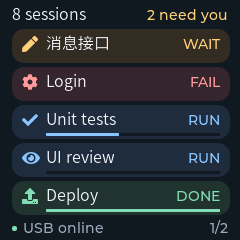
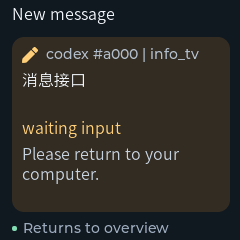
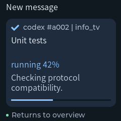
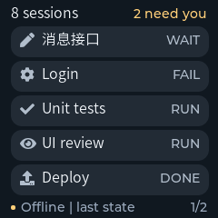
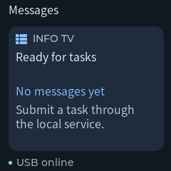

# Message bubble UI validation

Date: 2026-11-05

This revision adds optional preset task icons to the message API and renders
five compact conversations per page. It keeps the eight-card capacity,
six-second rotation, and notification scheduling. It changes the reusable LVGL widgets in
[ScreenView](../firmware/main/ui/screen_view.cpp).

## Layout

- Five message bubbles fit the 240 x 240 overview. Each bubble is a rounded
  rectangle with smooth edges and no tail.
- Each entry shows a preset icon, conversation title, and `RUN`, `WAIT`, `FAIL`,
  or `DONE` on one text line. Source, short card ID, and project appear in the
  expanded notification. Execution time is omitted pending its definition.
- Built-in LVGL symbols represent `task`, `code`, `test`, `build`, `review`, and
  `deploy`; these identify task purpose independently of state.
- Known progress occupies a reserved thin track below the title. Unknown progress
  hides the track, while known zero displays an empty track. Completion does not
  invent an unreported percentage. No layout shift occurs when progress changes.
- Body titles use the existing 16 px CJK font. Notification metadata and overview state use
  Montserrat 14 with the existing CJK font as fallback. This does not add Chinese
  glyph coverage.
- State text remains explicit. Soft amber, red, green, and blue surfaces and
  accents reinforce attention, failure, completion, and ordinary progress.
- Offline content uses neutral bubbles and no percentage or progress bar.
  The `Offline | last state` footer identifies cached content.
- Notifications use one large bubble with a two-line title, state, two-line
  summary, and an optional progress bar. Empty state reuses that surface.
- Global attention count, connection status, and page position remain outside
  the bubbles. Widgets are reused across updates.

## Desktop previews

These images use the production widget code and actual LVGL rendering. They are
native-size previews, not photographs of the device.

Overview:

Temporary notification:

Notification with reported progress:

Disconnected overview:

Connected empty state:

For reproducible rendering and PNG export, follow
[Preview the firmware UI without flashing](multi-conversation-validation.md#tip-preview-the-firmware-ui-without-flashing).
The screen test writes the current layout to the same `screen-*.ppm` paths;
the earlier document's checked-in PNGs preserve the original layout.

## Validation scope

The screen test traverses nested bubble widgets to check visible bounds and text.
It covers long-to-short updates, hidden conversations, offline percentages,
overview/notification/empty transitions, all six icon glyphs, and absent/zero/full
progress. Presentation tests cover five-row visibility feedback, hidden-page
updates, page fairness, and related-notification restoration.

Results: All four native CTest cases and 40 Python tests passed, including two
Python-to-C++ integration cases. Static analysis and generated binding checks
passed. The ESP-IDF v6.1 build passed; the binary is 698,144 bytes, with 33% of the existing
1 MiB app partition remaining. The bubble firmware has not been flashed.

The optional producer field `icon` defaults to `task`; unknown names are rejected
with 422. Icon identity participates in retry/conflict checks and device card
equality. `Hello.task_icons` is required by the updated host before synchronization,
so an older firmware cannot silently ignore selected icons. Update host and
firmware together for physical validation. The generated maximum envelope is
4045 bytes, below the unchanged 4096-byte frame payload limit.

Physical readability, panel colors, and refresh timing still need validation on
the device. The earlier layout's hardware confirmation does not validate this
revision.
