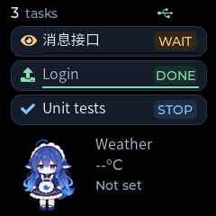

# Codex hook adapter

The Windows hook command translates native Codex callbacks and submits task
updates to the existing `POST /v1/task-events` endpoint. It runs once per
callback; the normal `info-tv` service owns USB and device delivery.

## Rust setup for this checkout

The repository's [project hooks](../.codex/hooks.json) forward six Codex events
through `.local/bin/info-tv.exe hook codex`. The executable is a local copy of the
optimized Rust build, so rebuilding under `host-rust/target` does not replace a
running service binary. Commands in this configuration use absolute paths for
this checkout; update them if the repository moves.

All six handlers share `.local/run/codex-hooks.sqlite3`. The Rust service uses
`.local/run/rust-host` for its durable state and listens on `127.0.0.1:8765`.
Its process details are saved in `.local/run/rust-host-process.json`. These local
artifacts are ignored by Git; the hook definitions are project configuration.

Codex discovers the project hooks, but new definitions initially have
`trustStatus: untrusted`. In the desktop app, use **Review hooks** or
**Settings > Hooks** to review and trust the six entries from this repository;
in the CLI, use `/hooks`. The [official hook reference](https://learn.chatgpt.com/docs/hooks)
requires trust before non-managed hooks run. Trust state is not changed by this
repository setup. After review, send another prompt to test native callbacks.

See [Rust host validation](rust-host-validation.md#physical-device-and-project-hook-follow-up)
for native callback delivery and its limits. The setup below uses the same
Rust adapters in a standalone installation.

## Install and configure

Extract the host archive to a stable path such as `C:\info-tv`, then start it:

```powershell
C:\info-tv\info-tv.exe serve
```

For source builds, see the [host guide](../host-rust/README.md).

`info-tv-hook codex` reads a single UTF-8 JSON callback from stdin. The equivalent
consolidated entry point is `info-tv hook codex`.

Add the following handlers to your Codex `hooks.json`. The paths below match
the installation above; update them if the installation moves. Use the installed
executable directly so hook invocations do not resolve dependencies or launch
another service. Merge these handlers with any existing configuration.

```json
{
  "hooks": {
    "UserPromptSubmit": [
      {"hooks": [{"type": "command", "command": "C:/info-tv/info-tv-hook.exe codex", "timeout": 3}]}
    ],
    "PreToolUse": [
      {"hooks": [{"type": "command", "command": "C:/info-tv/info-tv-hook.exe codex", "timeout": 3}]}
    ],
    "PermissionRequest": [
      {"hooks": [{"type": "command", "command": "C:/info-tv/info-tv-hook.exe codex", "timeout": 3}]}
    ],
    "PostToolUse": [
      {"hooks": [{"type": "command", "command": "C:/info-tv/info-tv-hook.exe codex", "timeout": 3}]}
    ],
    "Stop": [
      {"hooks": [{"type": "command", "command": "C:/info-tv/info-tv-hook.exe codex", "timeout": 3}]}
    ],
    "Interrupt": [
      {"hooks": [{"type": "command", "command": "C:/info-tv/info-tv-hook.exe codex", "timeout": 3}]}
    ]
  }
}
```

Codex supports user-level `~/.codex/hooks.json` and trusted project-level
`.codex/hooks.json`. Review and trust the handlers through `/hooks` in the CLI,
or the desktop hook settings, before expecting callbacks. Keep these handlers
synchronous. See the [official hook configuration reference](https://learn.chatgpt.com/docs/hooks).
The adapter returns neutral `{}` and does not approve commands or request that
Codex continue a turn. This implementation does not install or change your
normal Codex hook configuration automatically.

## State and identity mapping

| Native callback | Result |
| --- | --- |
| `UserPromptSubmit` | Start `running` for a previously unseen turn |
| `PermissionRequest` | Set `waiting_input`, with the tool name as approval detail |
| `PreToolUse`, `PostToolUse` | Return a known, nonterminal run to `running`; unchanged states are suppressed |
| `Stop` | Set `completed`, meaning the turn ended, without claiming task success |
| `Interrupt` | Set `interrupted`; never turn it into success or failure |
| `SessionStart`, `SessionEnd`, other events | No task state change |

The producer namespace is `codex`. Native `session_id` becomes
`conversation_id`, and native `turn_id` becomes `task_id`. The adapter allocates
an increasing `run_sequence` per conversation and increasing `sequence` per
execution. All callback processes must share the same state file. Different
conversations remain separate even in the same working directory; a new turn
reuses its conversation's card.

The first prompt supplies the stable conversation title. Each run's prompt
supplies its task title, and the working directory basename supplies `context`.
Controls and whitespace are collapsed; titles/context fit 64 UTF-8 bytes and
details fit 160. Labels are not identities. The built-in `code` icon is used,
and no progress percentage is invented. Tool arguments, command output, and
transcripts are not forwarded or read. The final assistant message may supply
the bounded completion detail.

Once a run becomes completed or interrupted, later callbacks for that run are
ignored. A terminal callback without a recorded start creates only a local
tombstone: it does not create a card or advance the conversation ordinal. A
subsequently delayed start cannot revive that turn. Unknown tool activity is
also ignored. Consequently, an extremely early interruption with no captured
start does not create a display entry.

Interrupted cards use neutral color and the compact label `STOP`, sort behind
running cards, and generate an ordinary terminal notification once. They expire
using the existing `completed_retention_seconds` setting, just like completed
cards. Notification queue capacity and offline behavior remain those of the
common task service. The wire contract already carries generic status text and
tone, so no Protobuf schema change is needed. Build and flash the updated
firmware to obtain the compact label and sorting behavior on a physical device.

CPU-rendered LVGL preview, not a device photograph:



## Durable ordering and retry

Default state file: `%LOCALAPPDATA%/info_tv/codex-hooks.sqlite3` on Windows, or
`~/.local/state/info_tv/codex-hooks.sqlite3` when `LOCALAPPDATA` is absent.
The file records run identities, bounded display labels, and pending event
bodies. SQLite transactions serialize ordinal/sequence allocation across
processes. No write transaction is held during HTTP delivery.

An event's UUID, sequence, and complete JSON body are committed before sending.
The payload remains pending until the host returns a recognized `202`
acknowledgment (`accepted`, `duplicate`, `stale`, or `closed`). If the host
accepted a request but its response was lost, retrying sends the exact same
body and UUID. Concurrent senders may send that same UUID; host deduplication
handles it.

The default service URL is `http://127.0.0.1:8765`. HTTP clients bypass
environment proxies. Each callback attempts queued delivery for a one-second
window with a default 0.5-second HTTP phase timeout. Connection errors, host
rejections, and malformed responses leave data queued and print a diagnostic
to stderr. Runtime errors return neutral JSON with a successful exit code,
so display forwarding does not reject a prompt, deny a tool, or continue a turn.
Storage failure is also reported, but cannot provide durable capture.

The next callback retries pending events first. To retry without a new agent
event, or target a different local service port:

```powershell
info-tv-hook codex --flush
info-tv-hook codex --url http://127.0.0.1:8766 --flush
info-tv-hook codex --state-file D:/info_tv-state/codex.sqlite3 --flush
```

A flush uses the same short delivery window; a large backlog may need another
flush or callback. Use the same URL/state options in every configured handler.
The adapter does not run a background retry process or automatically delete run
history. Keep the ledger while its conversations can resume; deleting it can
reuse ordinals that the running host still knows. The Rust host restores its own
accepted task state from SQLite after restart. Pending adapter updates can still
be retried; old pop-up notifications are not replayed.

## First-version limits

- `completed` describes end of a turn, not successful fulfillment of a request.
  This adapter assumes no other `Stop` hook requests continuation. A continuation
  policy needs a stronger final-turn signal before it can share this mapping.
- Tool failure, approval denial, and session closure do not imply a failed
  execution. The observed connection failure had no `Stop` callback. Such a run
  can remain displayed as running; this adapter does not invent `failed` from
  text, elapsed time, or `SessionEnd`.
- Approval waiting reflects the latest observed callback. A denial may remain
  waiting until later tool activity or the turn ends. Parallel pending approvals
  are not aggregated. Arbitrary questions to the user are not detected.
- Run ordinals reflect captured starts. The source provides no event sequence
  that could reconstruct arbitrarily reordered or missing native callbacks.
  HTTP retries and late callbacks from an already known older run are handled;
  full source-event replay/recovery is not claimed.
- One current execution per conversation is supported by the common host
  model. This version does not manage subagent cards or infer task-purpose icons.

These limits follow the [native event validation](codex-hook-validation.md).

## Verification

On 2026-11-07:

- **177 host tests passed**, including native C++ bridge integration and eleven
  new callback/queue tests. Coverage includes UTF-8 input, concurrent allocation,
  persistent process ordering, unknown terminal events, interruption, rejected
  acknowledgments, and a real API acceptance whose HTTP response is lost.
- **Four desktop CTest cases passed**, including interrupted ordering and real
  LVGL label/bounds checks. The screen case was rerun after final preview setup.
- Ruff, `uv run ty check`, and checked-in protocol generation checks passed.
- A real Codex **0.166.0** App Server drove two independent conversations through
  the installed `info-tv-hook.exe`, a real loopback HTTP server, and the desktop
  firmware bridge. The first conversation completed, reused its card for run
  two, and was interrupted. The second retained its own completed card. Both
  final revisions received native `Presented` feedback; the retry queue was
  empty. See [the saved host records](evidence/codex-adapter-smoke-2026-11-07.json).
- The ESP-IDF **6.1** firmware build passed using the existing configured CMake
  build and installed tool paths. The 872,672-byte application fits the existing
  1 MiB partition. No physical device was flashed or tested in
  this round. User-level hook configuration was not installed; all real-agent
  probes used a disposable Codex home and removed its temporary login copy.
