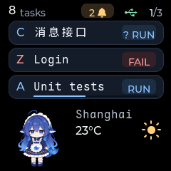

# Codex hook adapter

The Windows hook command translates native Codex callbacks and submits task
updates to the existing `POST /v1/task-events` endpoint. It runs once per
callback; the normal `info-tv` service owns USB and device delivery.

## Rust setup for this checkout

Use the seven-event configuration below for this checkout or a standalone
installation. Rebuilding under `host/target` does not replace an installed or
running service binary. Keep the service and hook executables at the same
version; older services do not accept the `closed` state.

Codex discovers the project hooks, but new definitions initially have
`trustStatus: untrusted`. In the desktop app, use **Review hooks** or
**Settings > Hooks** to review and trust the configured entries;
in the CLI, use `/hooks`. The [official hook reference](https://learn.chatgpt.com/docs/hooks)
requires trust before non-managed hooks run. Trust state is not changed by this
repository setup. After review, send another prompt to test native callbacks.

See [Rust host validation](rust-host-validation.md#physical-device-and-project-hook-follow-up)
for native callback delivery and its limits. The setup below uses the same
Rust adapters in a standalone installation.

## Install and configure

Extract the host archive to a stable path such as `C:\info-tv`, then start it:

```powershell
C:\info-tv\info-tv.exe serve
```

For source builds, see the [host guide](../host/README.md).

`info-tv hook codex` reads a single UTF-8 JSON callback from stdin.

Add the following handlers to your Codex `hooks.json`. The paths below match
the installation above; update them if the installation moves. Use the installed
executable directly so hook invocations do not resolve dependencies or launch
another service. Merge these handlers with any existing configuration.

```json
{
  "hooks": {
    "UserPromptSubmit": [
      {"hooks": [{"type": "command", "command": "C:/info-tv/info-tv.exe hook codex", "timeout": 3}]}
    ],
    "PreToolUse": [
      {"hooks": [{"type": "command", "command": "C:/info-tv/info-tv.exe hook codex", "timeout": 3}]}
    ],
    "PermissionRequest": [
      {"hooks": [{"type": "command", "command": "C:/info-tv/info-tv.exe hook codex", "timeout": 3}]}
    ],
    "PostToolUse": [
      {"hooks": [{"type": "command", "command": "C:/info-tv/info-tv.exe hook codex", "timeout": 3}]}
    ],
    "Stop": [
      {"hooks": [{"type": "command", "command": "C:/info-tv/info-tv.exe hook codex", "timeout": 3}]}
    ],
    "Interrupt": [
      {"hooks": [{"type": "command", "command": "C:/info-tv/info-tv.exe hook codex", "timeout": 3}]}
    ],
    "SessionEnd": [
      {"hooks": [{"type": "command", "command": "C:/info-tv/info-tv.exe hook codex", "timeout": 3}]}
    ]
  }
}
```

Codex supports user-level `~/.codex/hooks.json` and trusted project-level
`.codex/hooks.json`. Review and trust the handlers through `/hooks` in the CLI,
or the desktop hook settings, before expecting callbacks. Keep these handlers
synchronous. See the [official hook configuration reference](https://learn.chatgpt.com/docs/hooks).
The adapter returns neutral `{}` and does not approve commands or request that
Codex continue a turn. This implementation does not install or change your
normal Codex hook configuration automatically.

## State and identity mapping

| Native callback | Result |
| --- | --- |
| `UserPromptSubmit` | Start `running` for a previously unseen turn |
| `PermissionRequest` | Set `waiting_input`, with the tool name as approval detail |
| Accepted `request_user_input_async` in `PostToolUse` | Keep `running` and show a recent-question hint for 30 seconds |
| `PreToolUse`, `PostToolUse` | Return a known, nonterminal run to `running`; unchanged states are suppressed |
| `Stop` | Set `completed`, meaning the turn ended, without claiming task success |
| `Interrupt` | Set `interrupted`; never turn it into success or failure |
| `SessionEnd` | Submit `closed` for the latest recorded turn and remove its card without a completion notification |
| `SessionStart`, other events | No task state change |

The producer namespace is `codex`. Native `session_id` becomes
`conversation_id`, and native `turn_id` becomes `task_id`. The adapter allocates
an increasing `run_sequence` per conversation and increasing `sequence` per
execution. All callback processes must share the same state file. Different
conversations remain separate even in the same working directory; a new turn
reuses its conversation's card.

Codex's local `state_5.sqlite` supplies the conversation's user-facing `name`,
queried with a read-only SQLite connection and a 50 ms busy timeout. If no name
can be read, `session_index.jsonl` supplies the latest matching `thread_name`.
The adapter uses `CODEX_HOME`, or the current user's `.codex` directory when
unset. It reads only session identity/title metadata, so
renames are forwarded on the next nonterminal callback even when execution
state is unchanged. These are local metadata formats, not stable hook fields;
absent or unreadable metadata falls back to the last recorded title, then the
first prompt. No App Server process is launched by a hook.

Each run's prompt supplies its task title, and the working directory basename supplies `context`.
Controls and whitespace are collapsed; titles/context fit 64 UTF-8 bytes and
details fit 160. Labels are not identities. Updated firmware displays a `C`
source badge for Codex (`Z` for ZCode and `A` for AGY),
and no progress percentage is invented. Tool arguments, command output, and
transcripts are not forwarded or read. The final assistant message may supply
the bounded completion detail.

Once a run becomes completed or interrupted, later turn callbacks for that run
are ignored. `SessionEnd` still removes the card, including a completed card
within its retention window. It closes all recorded turns locally so late
callbacks cannot revive them. Resuming the conversation with a new turn still
allocates a greater run ordinal. A terminal callback without a recorded start creates only a local
tombstone: it does not create a card or advance the conversation ordinal. A
subsequently delayed start cannot revive that turn. Unknown tool activity is
also ignored. Consequently, an extremely early interruption with no captured
start does not create a display entry.

Interrupted cards use neutral color and the compact label `STOP`, sort behind
running cards, and generate an ordinary terminal notification once. They expire
using the existing `completed_retention_seconds` setting, just like completed
cards. Notification queue capacity and offline behavior remain those of the
common task service. The wire contract already carries generic status text and
tone, so no Protobuf schema change is needed. Build and flash the updated
firmware to obtain the compact label and sorting behavior on a physical device.

CPU-rendered LVGL preview, not a device photograph:


CPU-rendered LVGL preview of the recent-question hint, not a device photograph:



## Durable ordering and retry

Default state file: `%LOCALAPPDATA%/info_tv/codex-hooks.sqlite3` on Windows, or
`~/.local/state/info_tv/codex-hooks.sqlite3` when `LOCALAPPDATA` is absent.
The file records run identities, bounded display labels, and pending event
bodies. SQLite transactions serialize ordinal/sequence allocation across
processes. No write transaction is held during HTTP delivery.

An event's UUID, sequence, and complete JSON body are committed before sending.
The payload remains pending until the host returns a recognized `202`
acknowledgment (`accepted`, `duplicate`, `stale`, or `closed`). If the host
accepted a request but its response was lost, retrying sends the exact same
body and UUID. Concurrent senders may send that same UUID; host deduplication
handles it.

The default service URL is `http://127.0.0.1:8765`. HTTP clients bypass
environment proxies. Each callback attempts queued delivery for a one-second
window with a default 0.5-second HTTP phase timeout. Connection errors, host
rejections, and malformed responses leave data queued and print a diagnostic
to stderr. Runtime errors return neutral JSON with a successful exit code,
so display forwarding does not reject a prompt, deny a tool, or continue a turn.
Storage failure is also reported, but cannot provide durable capture.

The next callback retries pending events first. To retry without a new agent
event, or target a different local service port:

```powershell
info-tv hook codex --flush
info-tv hook codex --url http://127.0.0.1:8766 --flush
info-tv hook codex --state-file D:/info_tv-state/codex.sqlite3 --flush
```

A flush uses the same short delivery window; a large backlog may need another
flush or callback. Use the same URL/state options in every configured handler.
The adapter does not run a background retry process or automatically delete run
history. Keep the ledger while its conversations can resume; deleting it can
reuse ordinals that the running host still knows. The Rust host restores its own
accepted task state from SQLite after restart. Pending adapter updates can still
be retried; old pop-up notifications are not replayed.

## First-version limits

- `completed` describes end of a turn, not successful fulfillment of a request.
  This adapter assumes no other `Stop` hook requests continuation. A continuation
  policy needs a stronger final-turn signal before it can share this mapping.
- Tool failure, approval denial, and session closure do not imply a failed
  execution. The observed connection failure had no `Stop` callback. Such a run
  can remain displayed as running until `SessionEnd` removes it. The adapter
  does not invent `failed` from text or elapsed time. Configure `SessionEnd`
  explicitly when upgrading from the earlier six-event configuration.
- Normal Codex exit, or archiving/deleting an open conversation, emits
  `SessionEnd`. Closing a client window or switching conversations may leave
  a session alive until the source's inactivity grace period ends; abrupt
  process termination may emit no hook. Already orphaned cards need explicit
  closure through `info-tv task close <card_id>`; silence is not a closure
  signal. See the [official lifecycle description](https://learn.chatgpt.com/docs/hooks).
- The recent-question hint displays `? RUN` in the related overview row. It means
  a question was recently submitted, not that an answer is still pending. The
  adapter inspects only `request_user_input_async`'s acceptance flag and tool-call
  identity, handling both JSON objects and Codex's JSON-encoded string response.
  Duplicate callbacks do not renew the hint. A new accepted question renews it;
  ordinary activity preserves its original deadline. Completion, interruption,
  failure, closure, or a new run clears it. The deadline survives host restart;
  reconnect snapshots carry only its remaining lifetime, rounded up to seconds.
  Firmware expires the icon locally, even without another hook callback. Install
  both the updated host and firmware to display it. See the
  [native callback evidence](evidence/codex-async-question-hooks-2026-11-09.json).
- Approval waiting reflects the latest observed callback. A denial may remain
  waiting until later tool activity or the turn ends. Parallel pending approvals
  are not aggregated. Arbitrary prose questions are not detected; async question
  replies are not tracked, so answering does not dismiss the timed hint early.
- Run ordinals reflect captured starts. The source provides no event sequence
  that could reconstruct arbitrarily reordered or missing native callbacks.
  HTTP retries and late callbacks from an already known older run are handled;
  full source-event replay/recovery is not claimed.
- One current execution per conversation is supported by the common host
  model. This version does not manage subagent cards or infer task-purpose icons.

These limits follow the [native event validation](codex-hook-validation.md).

## Display corrections validated on 2026-11-09

- All **29 Rust tests**, Clippy with warnings denied, and rustfmt passed.
  Regressions cover closing the latest running or completed turn without a
  `turn_id`, repeated closure, late callbacks, a new resumed turn, retirement
  across host restart, full card capacity, and metadata fallback/rename behavior.
- All **five desktop CTest cases** passed, including the real LVGL screen.
  Overview and notification checks distinguish Codex, ZCode, and AGY while
  generic producers retain their task-purpose icons. The Rust integration suite
  also exercised the native C++ protocol bridge.
- The optimized Windows executable read the actual names of the two remaining
  local Codex conversations in an isolated-ledger smoke check. Its submissions
  targeted an unused loopback port; no synthetic cards were sent to the live
  display service. No Codex metadata was edited.
- The ESP-IDF 6.1 build passed. `firmware/build/info_tv.bin` is 4,695,696 bytes,
  within the configured 6 MiB application partition. Build success does not
  establish physical rendering; the service executable, user hook settings,
  and device firmware were not replaced during these checks.
- Two existing `## Memory` cards were backed up under the ignored
  `.local/display-fixes/` directory and closed through the live service's
  existing DELETE endpoint. Both returned `removed: true` while the device was
  online, and a subsequent task listing contained no matching cards. This is
  service admission evidence, not a device photograph.

Synthetic CPU-rendered preview of the source badges:


### Local deployment follow-up

After user approval on 2026-11-09, the updated executable was installed at
`C:\h\info-tv\info-tv.exe`, and the existing user-level hooks were preserved
while adding `SessionEnd`. The service was restarted in a hidden window using
its existing configuration and durable state. The installed executable's SHA256
matches the verified release build.

Before flashing COM6, the entire 16 MiB device flash was read back, and the
installed partition table was compared with the build. They matched. Only the
application at `0x10000` was written; esptool verified its hash and reset the
device. The backup, previous executable/configuration, consistent SQLite
backups, deployment logs, and verification records are under the ignored
`.local/display-fixes/deploy-20261109-215752/` directory.

The updated service reconnected with a new device session, no reported error,
the original two card identities, brightness 20, and fresh weather. Both cards
received physical `Accepted` and `Presented` feedback, and both conversation
titles matched the local Codex `name` metadata. The Codex outbox was empty.

A separate synthetic `UserPromptSubmit` callback through the installed adapter
created a temporary card and received physical `Presented` feedback. A
synthetic `SessionEnd` without `turn_id` then retired it, leaving the two real
cards. This verifies installed adapter/host/device delivery; it does not claim
that Codex emitted a native exit callback or provide a display photograph.

A read-only Codex 0.167.0 `hooks/list` query discovered all seven enabled
handlers. The original six remained trusted; the new `SessionEnd` was
`untrusted`. The user uses Codex CLI and will restart it to refresh hooks, then
review/trust the new entry with `/hooks`. Native exit cleanup remains pending
that step; no trust hashes were edited by the deployment.

## Verification

On 2026-11-07:

- **177 host tests passed**, including native C++ bridge integration and eleven
  new callback/queue tests. Coverage includes UTF-8 input, concurrent allocation,
  persistent process ordering, unknown terminal events, interruption, rejected
  acknowledgments, and a real API acceptance whose HTTP response is lost.
- **Four desktop CTest cases passed**, including interrupted ordering and real
  LVGL label/bounds checks. The screen case was rerun after final preview setup.
- Ruff, `uv run ty check`, and checked-in protocol generation checks passed.
- A real Codex **0.166.0** App Server drove two independent conversations through
  the installed `info-tv-hook.exe`, a real loopback HTTP server, and the desktop
  firmware bridge. The first conversation completed, reused its card for run
  two, and was interrupted. The second retained its own completed card. Both
  final revisions received native `Presented` feedback; the retry queue was
  empty. See [the saved host records](evidence/codex-adapter-smoke-2026-11-07.json).
- The ESP-IDF **6.1** firmware build passed using the existing configured CMake
  build and installed tool paths. The 872,672-byte application fits the existing
  1 MiB partition. No physical device was flashed or tested in
  this round. User-level hook configuration was not installed; all real-agent
  probes used a disposable Codex home and removed its temporary login copy.

On 2026-11-09, the recent-question hint was verified separately:

- A real Codex 0.167.0 process using deterministic loopback model responses
  emitted native async-question pre/post hooks. Replaying those captured
  callbacks through the release adapter produced running, running with the
  question ID, and completed events. No upstream model request was made.
- All 31 Rust tests and five desktop CTest cases passed. The HTTP-to-C++ bridge
  also accepted and presented a running card carrying the new field. Tests cover
  callback deduplication, ordinary activity, repeated questions, expiry without
  new callbacks, presentation feedback after expiry, and task completion.
- rustfmt, Clippy with warnings denied, and protocol generation checks passed.
  The generated maximum envelope remains 4,093 bytes. The 4,696,336-byte
  ESP-IDF 6.1 application builds within the configured 6 MiB app partition.
- Physical deployment was not performed during these checks: the running host
  reported no matching USB device, and serial enumeration returned no ports.
