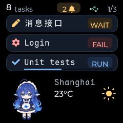
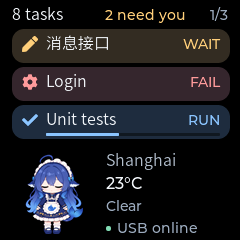
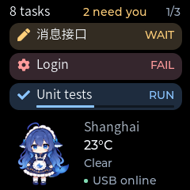

# Local companion animation

The [latest message styling](message-ui-polish.md) changes the header and bubble
surfaces. Animation behavior is unchanged; the GIF below shows the earlier
message styling.

Date: 2026-11-06

Status: Desktop-rendered and firmware-built. Firmware incorporating this animation
was [flashed on 2026-11-06](hardware-validation.md#7-companion-weather-and-alert-firmware-deployment);
visual smoothness remains unconfirmed. The previous static
companion/weather layout is committed as `a146a79`. Animation is a subsequent
change and does not modify the host API or wire protocol.

## Motion

The character stays inside the original 80 x 84 rectangle at (14, 152).
The source is YunYueSama's
[codex-deepseek-pet](https://github.com/YunYueSama/codex-deepseek-pet) at revision
`7661c8b304c5400701f91da01b1a643a207331de`. Selection, transparent-margin trimming,
and resizing are the only artwork modifications; the complete
[attribution, source hashes, and license](../firmware/main/ui/assets/README.md)
accompany the generated frames and previews.

- Normal idle uses the unchanged open-eyed pose.
- Blinks use the original closed-eye pose for 140 ms. The upstream interval
  sequence is 5200, 7100, 4300, 8600, and 6100 ms, repeating after 31.3 seconds.
  Closure runs from 170 ms before each interval ends until 30 ms before it ends.
- A weight shift starts at 15 seconds in each 24-second cycle. The dense-idle
  source frames are 1, 3, 5, 7, 5, 3, 1, held for 75, 80, 90, 100, 90, 80, and
  100 ms. Total motion is 615 ms; then the character returns to idle. Weight
  shifts take priority if they overlap a scheduled blink.

All poses preserve the full character and share a foot baseline. Motion is
sampled from monotonic time, so delayed rendering skips obsolete poses instead
of accumulating them. Message updates, page changes, and notifications do not
restart the motion clock. Offline animation continues while the backlight is
on. At zero brightness, character sampling and animation-only flushes stop;
reenabling resumes at the current time without replaying missed actions.

## Rendering and feedback

`ScreenView::animate(nowMs)` changes the image source only when its sampled pose
changes. It creates no timers or dynamic widget trees. Normal idle therefore
does not cause repeated redraws. No WebGL interpolation, transform scaling,
HTTP animation commands, or task-state-triggered reactions are introduced.

The sole UI task samples motion after previous DMA completion. Every physical
refresh has a new frame identity, independently of the current content render
generation. This lets `hasPendingFrame()` protect an animation refresh even
when task content has not changed. Actual completion is mapped back to the
rendered content generation for existing per-card/notification Presented logic.
Animation does not create new content generations or restart notice durations.

The display's automatic LVGL refresh timer is removed: all refreshes pass through
`DisplayDriver::present()`, keeping DMA identity and completion correlated.
Content changes invalidate the whole screen. Animation-only refreshes use the
already-invalidated character rectangle, leaving weather and messages intact.
Backlight-off rendering and Presented suppression keep their existing behavior.

## Actual LVGL preview

This 24-second preview uses the real production widgets and source frames at
240 x 240. The first blink starts at 5.03 seconds and the weight shift at
15 seconds. GIF timing is quantized to 10 ms; it does not measure physical
SPI/DMA performance. Weather values are fixed fixtures, not current conditions.



| Blink | Weight shift |
| --- | --- |
|  |  |

The screen test writes `screen-animation-*.ppm` and `screen-animation.csv` to
the native build directory. The CSV lists each actual changed frame and its
duration. Rebuild and run the screen test using the
[existing preview instructions](multi-conversation-validation.md#tip-preview-the-firmware-ui-without-flashing).
To export a GIF with Pillow in a temporary environment, without adding a host
dependency, run from the root:

```powershell
$export = @'
import csv
from pathlib import Path
from PIL import Image
rows = list(csv.DictReader(Path('build/native-tests/screen-animation.csv').open()))
images = [Image.open(row['frame']).convert('RGB') for row in rows]
palette = images[0].quantize(colors=256)
frames = [image.quantize(palette=palette, dither=Image.Dither.NONE) for image in images]
frames[0].save('build/native-tests/companion-animation.gif', save_all=True,
    append_images=frames[1:], duration=[int(row['duration_ms']) for row in rows],
    loop=0, disposal=1, optimize=False)
'@
uv run --no-project --python host/.venv/Scripts/python.exe --with pillow python -c $export
```

## Verification

All four native CTest cases passed. The extended real-LVGL test checks blink
boundaries, unchanged-pose suppression, skipped-frame behavior, return to idle,
and independence from message widget updates. Fifteen rendered states span the
24-second preview. Every state stays within screen bounds, differs from the
previous pose, and leaves every pixel outside the character rectangle unchanged.
Existing paging, weather, notification, and progress tests still pass. A second
desktop display uses a 24-line partial RGB888 buffer and the production manual
refresh mode. It verifies that the LVGL timer handler cannot flush on its own,
that changed poses flush exactly 80 x 84 pixels, and that an unchanged pose
flushes nothing. Reopening eyes restores the original pixels without trails.

The ESP-IDF v6.1 build passed. `info_tv.bin` is 869,120 bytes, leaving 17% of the
existing 1 MiB application partition free. SHA-256:
`EB9AEEBC569C00F2450144163369C07A3C6479BBF36B042D02B64367FA14DAC0`.
The six uncompressed frame arrays occupy 161,280 bytes of flash. Host code and
generated bindings are unchanged from the verified static-layout commit.

Physical animation smoothness, RGB565 image appearance, DMA sequencing, and
backlight-off/resume behavior still need device validation. Desktop tests use
RGB888 buffers with immediate flush completion, so they do not establish
physical refresh performance or exercise the ESP-IDF driver.
