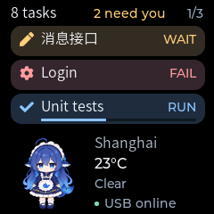
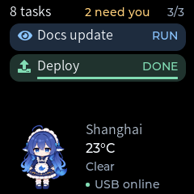
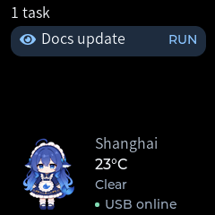
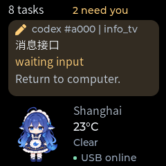
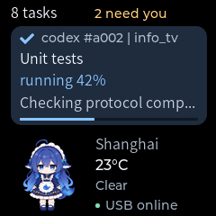
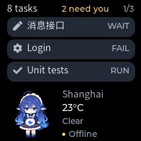
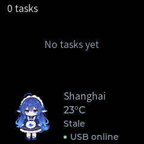
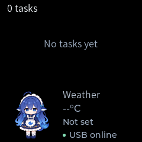

# Companion and persistent weather UI

Date: 2026-11-06

Status: Implemented, desktop-tested, and firmware-built. Firmware incorporating
this layout was [flashed on 2026-11-06](hardware-validation.md#7-companion-weather-and-alert-firmware-deployment).
Previous visual confirmation applies to the earlier message UI, not this revision.

This record describes the static layout committed as `a146a79`. The subsequent
[local animation revision](companion-animation.md) adds blinking and occasional
weight shifts; its build size and validation are recorded separately.

For the latest header and message surface styling, see
[Message UI polish](message-ui-polish.md). The captures below preserve the
original layout revision.

The [weather extension](weather-ui-validation.md) adds icons, daily temperature
ranges, and independent hazard alerts. Its current protocol bound and required
capability supersede the original weather-only values recorded below.

## Accepted layout

The 240 x 240 display keeps three independent regions:

| Region | Geometry | Content |
| --- | --- | --- |
| Header | y = 5..25 | Total task count, nonzero attention count, and page position |
| Messages | y = 29..139 | Up to three 218 x 34 rounded bubbles, spaced 38 px apart |
| Persistent area | y = 148..239 | Full-body character on the left; weather and USB state on the right |

The header uses `8 tasks`, `2 need you`, and `1/3` in separate bounded labels.
No attention label appears when its count is zero. A single page has no page
label. Up to eight current tasks still fit across three pages, with six-second
rotation and existing attention ordering. A partially populated last page never
duplicates entries to fill empty slots.

One or two tasks stay aligned to the top at the same size and spacing as a full
page. The remaining slots are pure black, without placeholder bubbles. With no
tasks, a small `No tasks yet` label occupies the message area. Neither case moves
or enlarges the persistent area.

The character uses an 80 x 84 transparent image at (14, 152), preserving the full
pose. The right column starts at x = 106. City, temperature, condition/freshness,
and USB state have separate lines. The outer background remains `#000000`.
Task icons, semantic surface colors, and reported progress retain their existing
behavior. Offline task rows use neutral colors and hide progress.

A notification temporarily replaces only the message area with a 110 px bubble.
It has one line each for source/project, title, state, and detail, plus an optional
progress bar. Long text truncates; full details remain on the computer. The
character, weather, and connection column remain visible. Notification timing,
interruption, restoration, and actual task Presented feedback retain their
existing semantics. Weather refreshes do not reset page rotation.

System labels remain English. Temperature explicitly uses Montserrat 16 so the
degree sign renders correctly. City labels can contain at most 24 UTF-8 bytes;
the existing CJK subset still does not cover arbitrary Chinese city names.

## Weather API

The host accepts producer-supplied weather; it does not fetch from a weather
provider or infer a city. No fictional weather is installed at startup.

```powershell
$weather = @{
    location = 'Shanghai'
    temperature_c = 23
    condition = 'clear'
    valid_for_seconds = 1800
} | ConvertTo-Json
Invoke-RestMethod -Method Put -Uri http://127.0.0.1:8765/v1/weather `
    -ContentType application/json -Body $weather
Invoke-RestMethod http://127.0.0.1:8765/v1/weather
Invoke-RestMethod -Method Delete -Uri http://127.0.0.1:8765/v1/weather
```

The example values are fixtures, not current conditions.

`PUT /v1/weather` replaces one retained observation and returns HTTP 202. Required
fields are a nonblank printable `location`, integer `temperature_c` in -100..100,
and `condition`: `unknown`, `clear`, `cloudy`, `rain`, `snow`, `storm`, or `fog`.
Optional integer `valid_for_seconds` defaults to 1800 and accepts 1..3600. The
producer should submit remaining freshness, accounting for observation age.
Boolean/string/float temperatures, invalid enums, control characters, excessive
UTF-8 labels, and extra fields receive 422 without changing retained values.

`GET /v1/weather` reports `state` (`unavailable`, `fresh`, or `stale`), retained
location, temperature, condition, remaining `valid_for_ms`, and delivery. Weather
also appears under `GET /v1/device`. Zero and negative temperatures are valid.
Weather has its own state and does not consume any of the eight task slots.

HTTP 202 means host retention. `delivery.accepted` means device UI admission;
weather does not claim separate Applied or Presented feedback. Before admission,
delivery is `{"state":"pending"}`. Device errors remain visible in delivery.
`DELETE /v1/weather` returns 202 and queues an explicit clear. All state is local
to one application process and resets on host restart.

Without data, the display shows `Weather`, `--°C`, and `Not set`. On expiry,
cached values remain dimmed with `Stale`; USB connection status remains separate
because fresh cached weather can outlive a brief disconnect. Expiry is enforced
locally on the device even if the host is gone. Reconnection synchronizes only
still-fresh observations; stale data is not revived and the device instead shows
the unavailable state. The host can still report the old observation as stale.

## Wire behavior

`Hello.weather = true` is required before synchronization. This needs a paired
host/firmware update. Protocol version 1 and all existing field numbers remain
unchanged. `Envelope.weather` (19) carries an absolute update. `Snapshot.weather`
(2) synchronizes the persistent area alongside the current cards.

`Weather` contains a bounded location, presence-aware signed integer temperature,
condition enum, and remaining `valid_for_ms` in 1..3600000. A fully empty Weather
is the explicit clear; other partial values are rejected. Snapshot validation
includes weather before changing UI state. The generated worst-case envelope is
4087 bytes, within the unchanged 4096-byte frame limit.

Updates coalesce before sending and use the normal ordered command/Accepted
retry path. Original deadlines survive retries: the host sends decreasing
remaining validity, and the device anchors expiry to receive time, including UI
queue delay. A duplicate accepted operation does not renew weather or reset
rotation. Weather expiry itself creates a new render generation without a host
command. Superseded weather does not generate task or notification events.

## Actual LVGL output

These native 240 x 240 PNGs come from the production ScreenView and LVGL renderer,
not photographs. Shanghai/23°C/Clear is a fixed rendering fixture.

| Three tasks | Two tasks on the final page | One task |
| --- | --- | --- |
|  |  |  |

| No tasks | Notification | Notification progress |
| --- | --- | --- |
|  |  |  |

| Offline | Stale weather | Unconfigured weather |
| --- | --- | --- |
|  |  |  |

See [the existing rendering tip](multi-conversation-validation.md#tip-preview-the-firmware-ui-without-flashing)
for build and PPM-to-PNG export commands. The screen test additionally exports
`screen-one.ppm`, `screen-two.ppm`, `screen-progress.ppm`, `screen-stale.ppm`, and
`screen-unavailable.ppm`.

Character artwork: **YunYueSama**, from
[codex-deepseek-pet](https://github.com/YunYueSama/codex-deepseek-pet), modified by
frame selection, transparent-margin trimming, and proportional resizing.
The [asset record and complete upstream license](../firmware/main/ui/assets/README.md)
accompany the embedded pixels and these screenshots.

## Verification

- 73 Python tests passed: 71 unit cases and two Python-to-C++ bridge integration
  cases. Static analysis and generated-binding checks passed.
- All four native CTest cases passed. The renderer checks widget bounds, sparse
  pages, zero tasks, header suppression, notifications, offline progress, and
  absent/zero/full progress. Pixel comparisons verify that the persistent area
  stays identical across one/two/three-task pages and notifications.
- Core tests cover all three pages, hidden update visibility, related-card
  restoration, independent weather admission, expiry, retry deduplication,
  explicit clear, old-session rejection, enum/range validation, and the maximum
  eight-card snapshot with weather.
- Host tests cover weather coalescing, decreasing retry validity, Accepted
  correlation, no false Presented, expired reconnect synchronization, capability
  rejection, invalid API inputs, clearing, zero degrees, and app isolation.
- ESP-IDF v6.1 firmware build passed: `info_tv.bin` is 734,208 bytes with 30% of
  the 1 MiB app partition free. SHA-256:
  `C69F819F1AF3A8D36B76B05D3FCCE505E4B91B361FD35A44028555D519C07688`.
  Physical readability, RGB565 panel output,
  brightness, and refresh behavior remain unverified for this revision.
