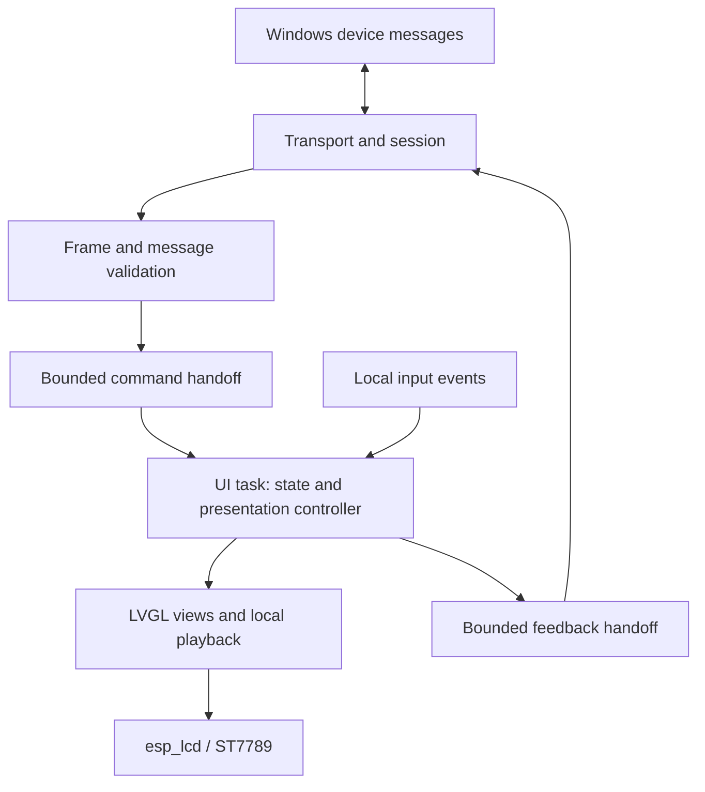

# ESP32 Firmware Architecture

Status: ESP-IDF, integrated FreeRTOS, C++, LVGL, ST7789 integration through esp_lcd, and the initial communication/UI task split are confirmed. Versions, task resource settings, and detailed protocols remain open.

Updated: 2026-11-03

## 1. Purpose and Scope

Implement the ESP32 side of the [Software Architecture](architecture.md) and satisfy the observable behaviors in [Requirements Analysis](requirements.md). Board wiring and device identification are recorded in [Hardware Reference](hardware-reference.md).

The firmware receives source-independent display content, retains the state needed to show it, arbitrates local presentation, and drives the screen and touch input. Windows remains the owner of business state, producer integration, and preparation of the device-facing content.

## 2. Technology Foundation

| Concern | Choice | Status | Reason |
| --- | --- | --- | --- |
| Framework | ESP-IDF | Confirmed | Use the official platform framework and the existing local development environment |
| Application language | C++ | Confirmed | Express owned state and focused modules while interoperating with ESP-IDF APIs |
| Runtime | ESP-IDF's integrated FreeRTOS | Confirmed | Provide task scheduling, queues, synchronization, and timing within the firmware |
| GUI | LVGL | Confirmed | Build reusable text, list, status, and media views while iterating layout and style |
| Screen access | `esp_lcd` with its ST7789 driver | Confirmed | Reuse the official panel interface and the documented board configuration |
| Initial transport | USB Serial/JTAG | Proposed | Start with the diagnostic connection already observed on the physical device |

The user confirmed the ESP-IDF/FreeRTOS runtime choice on 2026-11-03. FreeRTOS is integrated into ESP-IDF and compiled with the application into the firmware; it is not a separately installed operating-system image. ESP-IDF starts the scheduler automatically and invokes the application entry point. See the [official FreeRTOS overview](https://docs.espressif.com/projects/esp-idf/en/stable/esp32s3/api-reference/system/freertos.html).

The user also confirmed C++, LVGL, `esp_lcd` ST7789 integration, and the communication/UI application task split on 2026-11-03. Use FreeRTOS task, queue, synchronization, and timing facilities for this arrangement. Framework components may create their own background tasks; this is not a claim that the entire firmware has only two tasks.

ESP-IDF documents the [common LCD API and ST7789 support](https://docs.espressif.com/projects/esp-idf/en/stable/esp32s3/api-reference/peripherals/lcd/index.html). Its LCD examples also demonstrate LVGL integration. The vendor Arduino project remains the reference for wiring, inversion, backlight polarity, and initialization behavior; this proposal does not require retaining its weather application.

Exact ESP-IDF and LVGL versions and their compatibility must be checked and pinned during implementation setup. Component selection does not imply the latest published version will be adopted automatically.

## 3. Logical Modules

| Module | Responsibility |
| --- | --- |
| Transport and session | Read/write framed messages, report connection changes, and send queued feedback over the active transport |
| Message validation | Check the supported device contract and limits, then produce owned internal commands |
| Display state | Retain current overview/card content, pending notifications, and the displayed-content revision needed for recovery and feedback |
| Presentation controller | Choose overview, notification, or idle animation; apply priority and timing; handle local input; restore the overview |
| Views and media | Map supported display content to LVGL widgets and cached image/animation assets |
| Board support | Initialize SPI/ST7789, backlight, GPIO5 touch sensing, and required board-specific settings |

These are logical boundaries, not a requirement to create one task or class per row. Keep helpers and state ownership explicit without introducing a general-purpose plugin framework.

The display state is a cache of device-facing content. It does not mirror Windows' entire task store, parse agent events, or retrieve weather and calendar information independently.

## 4. Confirmed Data Flow and Task Ownership

The confirmed initial application task split is:

1. **Communication:** transport reads/writes, framing, message validation, connection events, and outbound feedback. A slow connection must not stall local UI timing.
2. **UI:** owns the display state and presentation controller, consumes incoming commands and input events, updates widgets, and services LVGL timing and animation.

Framework and driver tasks may exist in addition to these roles. Priorities, stack sizes, and core affinity follow measurement rather than being fixed by this document. Add further application workers only if implementation measurements justify them.

Use one UI owner for normal LVGL operations and timer-handler execution. Communication and interrupt callbacks hand off events instead of modifying widgets or the display model. LVGL documents this approach as a gateway thread in its [threading considerations](https://lvgl.io/docs/open/9.3/details/integration/adding-lvgl-to-your-project/threading).

Espressif's optional [esp_lvgl_port](https://components.espressif.com/components/espressif/esp_lvgl_port) supplies LVGL task/timer integration. If selected, reconcile its ownership and locking model with the application UI work rather than creating another independent LVGL timer-handler owner. Using the port versus a directly owned UI loop is an implementation choice.

Commands crossing task boundaries must own their content or carry an explicit ownership transfer. Do not enqueue pointers into reusable receive buffers. Queue limits and overload responses will be defined with the protocol; reception feedback must not claim admission for content that could not be retained.

## 5. Presentation State and Generic Views

Keep overview content separate from temporary presentation. A notification temporarily takes the screen without deleting the current overview or resolving any waiting-for-input or failed item within it. Idle animations yield to important notifications and normal information display resumes afterward.

The presentation controller applies Windows-supplied priority and validity metadata. It does not reclassify an event by recognizing a producer such as Codex. View templates may understand generic status, list, or metric data without understanding the original source.

Proposed initial templates are text, list, status, metric, and media views. Exact templates and supported fields remain open. Do not make arbitrary widget trees, executable scripts, or unrestricted coordinates part of the initial contract.

Local timing and view styling remain adjustable for rendered/device evaluation under the requirements document. Changing a font, spacing, or card layout should not change producer submission behavior.

## 6. Synchronization and Feedback

Binary Protobuf, the envelope/operation/view structure, card/notification separation, overview-only snapshots, service-session rule, and Accepted/Presented milestones are confirmed. The contract and binary framing options are tracked in [Windows-to-ESP32 Message Format](device-protocol.md). Nanopb remains recommended for evaluation; concrete fields, handshake mechanics, ordering representations, and feedback correlation remain open.

- On connection or device restart, establish the connection under the Windows service session and obtain a current valid overview snapshot before treating that content as synchronized. The snapshot does not replay notification history; a Windows service process restart creates a new service-session identity.
- Distinguish local last-known content from synchronized current content. Remain responsive and indicate disconnection or staleness while showing cached information when powered.
- Define object revisions or equivalent ordering semantics so an older update cannot overwrite a newer accepted state. Define event identity so a retried notification does not repeatedly interrupt.
- Use Accepted after the UI owner applies state or admits a notification, and Presented after the content becomes visible and the agreed first-refresh milestone completes. Decode success alone is neither milestone. The precise refresh event and feedback correlation remain design details.
- Retain the agreed reconnection behavior: current state replaces obsolete progress, and expired reminders are not replayed.

Protocol versions, capability negotiation, snapshot application, feedback fields, and retry/session details require subsequent design. Disk/Flash persistence across power loss and pending-notification retention remain deferred; this proposal does not turn powered offline caching into a durable-storage requirement.

## 7. Memory, Media, and Hardware Access

Start with partial display buffers and local refresh for the SPI screen, then measure refresh and animation performance. Do not require full-screen double buffering solely because the device reports 8 MB PSRAM.

Keep initial SPI transfer buffers in memory supported by the selected driver/DMA configuration. Use PSRAM for larger content or decoded assets after initialization and allocation have been verified. Keep reusable source assets in Flash where appropriate; storage format and update mechanism remain open. Decode incrementally or with bounded work so an animation does not starve the UI. Add a decode worker only if measurement shows it is needed.

GPIO5 connects to a capacitive touch electrode. Adapt it into local input events after validating sensing thresholds; do not treat it as a touchscreen or assume an ordinary digital push-button circuit. Intended input actions are still undecided.

USB Serial/JTAG has an official [bidirectional serial interface](https://docs.espressif.com/projects/esp-idf/en/stable/esp32s3/api-guides/usb-serial-jtag-console.html). Keep binary Protobuf frames distinguishable from boot and application logs. Logging routing/framing and startup recovery remain part of transport design.

## 8. Decisions to Review Next

1. Compatible ESP-IDF/LVGL versions and whether to use `esp_lvgl_port` or a directly owned UI loop while preserving the confirmed single UI owner.
2. Task priorities, stack sizes, core placement, and command/feedback handoff limits for the confirmed communication/UI split.
3. Supported device messages, view templates, limits, identity/revision semantics, and synchronization/feedback behavior.
4. Partial-buffer sizing, asset representation, touch handling, and on-device performance validation.

No firmware has been implemented or flashed as part of this architecture documentation.
