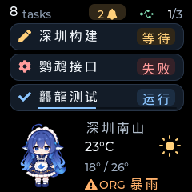
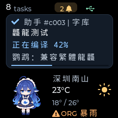
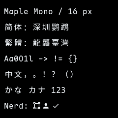
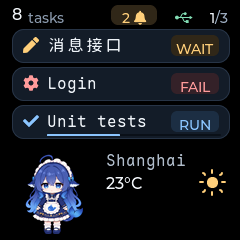

# Maple Mono NF CN conversion and validation

Validation date: 2026-11-08.

The firmware now uses the complete encoded glyph set from Maple Mono NF CN
Regular v7.9 at 16 px and 4 bpp. Compact metadata retains Montserrat 14 with
Maple Mono as its CJK fallback; task icons and fixed numeric widgets retain
their existing Montserrat fonts. Font data lives in Flash, without enabling
PSRAM or loading the whole font into RAM.

## Reproduce the asset

Firmware and desktop UI builds compile the committed C font directly.
PowerShell/Bash build scripts, direct `idf.py build`, and native CMake builds
do not invoke conversion or require Node.js/npm. Font conversion is a separate
maintenance operation; update the generated C asset alongside generator changes.

Generation requires Python 3.12+ and Node.js/npm; no installed source font is
needed. To explicitly regenerate from PowerShell at the repository root:

```powershell
./scripts/firmware/generate_font.ps1
```

The PowerShell entry point invokes the cross-platform Python standard-library
script. On Linux, or to use a specific Python interpreter, run:

```bash
python3 scripts/firmware/generate_font.py
```

The script downloads the official
[v7.9 release archive](https://github.com/subframe7536/maple-font/releases/tag/v7.9),
checks its pinned SHA-256, extracts only the Regular TTF and license, and checks
the TTF's pinned SHA-256. It runs `lv_font_conv@1.5.3` with 16 px, 4 bpp,
no compression, and no kerning. Skipping kerning suits this monospaced font and
avoids a pairwise scan over tens of thousands of characters. The first run
requires access to GitHub Releases and the npm registry; subsequent runs reuse
the verified archive in `build/fonts/upstream` and converter in `build/npm-cache`.

Files under `firmware/main/ui/fonts/`:

- `font_maple_mono_16.c`: generated LVGL C asset, symbol `font_maple_mono_16`,
  kept in version control with LF line endings to preserve its recorded hash.
- `OFL.txt`: the unmodified release archive's `LICENSE.txt`, kept in version control.
- `README.md`: asset attribution and regeneration instructions, kept in version control.

The converter writes a temporary file and publishes the C asset only after
successful conversion. A failed download, checksum, or conversion fails the
maintenance command without replacing the existing C asset. Font regeneration
needs network access unless the upstream and npm caches are already populated;
ordinary builds have no font-download dependency.

The default range U+0020–U+10FFFF exports all available encoded characters in
that range, including supplementary-plane Nerd Font icons. Unencoded alternate
glyphs and OpenType ligature/shaping behavior are not preserved. Conversion
options are documented in the official
[LVGL converter](https://github.com/lvgl/lv_font_conv).

To generate a text-oriented comparison outside the production source tree:

```powershell
./scripts/firmware/generate_font.ps1 `
    -OutputPath 'build/fonts/font_maple_mono_text_16.c' `
    -Range '0x20-0x7E,0x2000-0x206F,0x3000-0x30FF,0x4E00-0x9FFF,0xFF00-0xFFEF'
```

Each requested range must contain at least one supported character. Both assets
use the same public symbol, so only one should be compiled into an application.

## Pinned inputs and coverage

| Input | SHA-256 |
| --- | --- |
| `MapleMono-NF-CN.zip`, official v7.9 release | `af913b6322905348b3f50e4397fedc35b3a880db5effcce7969003051dcd3e94` |
| Extracted Regular TTF, 20,649,812 bytes | `bb8e8e8c263896f42555107202f1847f7a42c340a3e532df9c4d585c9794411c` |
| Generated production C asset | `e7e4208503d04e168cc94222a50d364d823b09fafd9399fcdaa1c48e4c491cc3` |

The TTF's internal version is 7.900. It has 33,091 Unicode-map entries and the
converter exports 33,089 glyphs from U+0020 onward. Basic Han coverage is 20,976
of the 20,992 code points U+4E00–U+9FFF. Extension A is absent. Complete export
of this font therefore does not imply complete Unicode Han or emoji coverage.
The earlier assessment used a locally installed TTF with a different hash; all
production generation and previews here use the pinned official release.

## Layout and storage

The generated font requires a 30 px line height and a 9 px baseline, compared
with the former Source Han subset's 20 px line height and 5 px baseline. Body
labels now reserve the full 30 px and move upward to keep text near its previous
baseline. The 18 px metadata line box and 2 px baseline accommodate CJK fallback
ink without cutting off its top. Font glyph data and global metrics are intact.
The existing three-row overview, notification bubble, weather area, and animation
remain in place. Wider Chinese advances (nominally 19.2 px) naturally cause some
long labels to reach the existing ellipsis sooner.

`CONFIG_LV_FONT_FMT_TXT_LARGE=y` is enabled consistently for firmware and desktop
LVGL. The old built-in CJK subset is disabled. The custom
[`partitions.csv`](../firmware/partitions.csv) keeps NVS at `0x9000`, PHY at
`0xf000`, and the factory app at `0x10000`, enlarging the app to 6 MiB within the
detected 16 MB Flash. This remains a single-app layout without OTA slots.
An existing ignored `firmware/sdkconfig` takes precedence over defaults: set
custom partitions and large-font support there and disable the old Source Han
font when migrating an existing build directory.

The font object contains 4,004,125 bytes (3.82 MiB) of read-only payload, with no
object-level data/BSS sections. The ESP-IDF v6.1 firmware build produces a
4,683,792-byte image (4.47 MiB), leaving 1,607,664 bytes (26%) of its 6 MiB app
partition. Image SHA-256 for this validation build:
`3cb4c58767954bcec52b48ad24b1e6ebaa624f6b3b596e98cd2f4316d6d17072`.
The font object size is not a measurement of runtime rendering allocations.

## Desktop rendering validation

Run the existing native tests and actual LVGL renderer:

```powershell
cmake -S firmware/tests -B build/native-tests -DINFO_TV_BUILD_UI_TESTS=ON
cmake --build build/native-tests --config Debug
ctest --test-dir build/native-tests -C Debug -LE hardware --output-on-failure
```

All four tests pass. Firmware and native UI builds compile the committed font
without invoking its generator; both were verified with Node/npm commands
blocked. Python Ruff and ty checks pass. A fresh
ESP-IDF configuration also selects the custom
partition table and large-font support from `sdkconfig.defaults`, with the old
Source Han font disabled. The screen test verifies basic Han coverage, representative
rare characters, a supplementary Nerd glyph, and visible labels' glyph ink
bounds in addition to widget bounds. It covers Chinese metadata and weather,
long-to-short updates, ellipsis, and the existing overview, notification,
weather, offline, progress, and partial animation behavior. MSVC uses UTF-8 for
the generated C comments and Chinese test strings.

The test writes `screen-chinese-overview.ppm`, `screen-chinese-notification.ppm`,
`screen-chinese-long.ppm`, and `screen-font-specimen.ppm` under
`build/native-tests`. For native-size PNG export, use the existing
[PPM-to-PNG instructions](multi-conversation-validation.md#tip-preview-the-firmware-ui-without-flashing).
The PNGs below are actual 240 x 240 LVGL output, visually checked at native size.

| Chinese overview | Chinese notification |
| --- | --- |
|  |  |

| Long Chinese labels | Font specimen |
| --- | --- |
|  |  |



Glyphs, punctuation, baselines, and ellipsis are visible without vertical clipping
in these cases. Dense rare characters remain dense at this size. Desktop checks
do not establish physical panel readability, colors, SPI timing, or power-cycle
behavior. No firmware was flashed during this work. Deployment must include the
new partition table along with the application; app-only updates retain the old
1 MiB partition limit.
