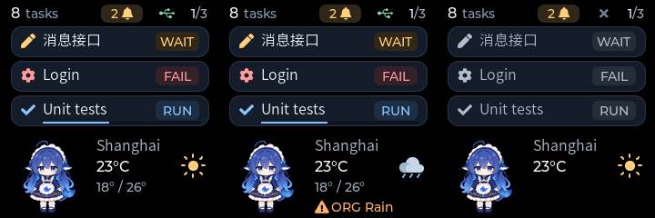

# Header connection icon and separate weather lines

Date: 2026-11-06

Status: Native-tested, firmware-built, and flashed on COM6. Five restored demo
cards returned actual device Presented feedback. Visual confirmation is pending.

## Actual LVGL output

Left to right: connected weather with range, connected weather with warning,
and disconnected state. These are real desktop LVGL renders with synthetic
data, not photographs of the physical panel.

## Layout

The connection indicator is now a 16 x 18 label at (176, 7), between the
attention badge and page position. It uses the bundled Montserrat 14 USB glyph
in green when the device's host session is connected. A gray cross indicates
no connected session. The icon describes the actual device-host link, not
whether cached weather is fresh.

USB is the only implemented transport. Bluetooth and Wi-Fi symbols are bundled
in LVGL, but those transport paths are not implemented or advertised. No new
protocol field or artificial connected state was added.

The former USB footer and dot are removed. The persistent weather column is:

| Position | Content |
| --- | --- |
| (106, 151) | City |
| (106, 174), icon at (196, 169) | Current temperature and weather symbol |
| (106, 198) | Fresh daily low/high, `Stale`, or `Not set` |
| (106, 220) | Active warning only |

Condition names such as `Clear` and `Rain` are omitted because the weather icon
already conveys them. A fresh observation without a reported range leaves the
range line blank. The bottom line is hidden without an active warning. A warning
retains its symbol/severity/title independently of the range or freshness line;
both the range and a valid warning can be shown together. Unknown/missing data
does not gain placeholder metrics. See [missing weather](images/header-unavailable.png).

Task layout, notice timing, companion motion, pure-black background, APIs,
and all freshness/alert validity rules are unchanged. This revision adds no
forecast, sunrise/sunset fields, or provider integration.

## Verification and deployment

All four native CTest targets pass. The screen checks cover the connected and
disconnected glyphs, visible-widget bounds, range/alert states, stale weather,
and unchanged pixels outside animation refreshes. Actual rendered images were
reviewed for header spacing, range placement, and a separate warning line.

ESP-IDF v6.1 builds an 872,368-byte app, leaving 17% of the 1 MiB app partition
free. SHA-256:
`326DC136CC431DB024EF66433ED7A1651A435B1BB4D99F9D26B1ED42F472B539`.
The deployed build uses source based on `aabb11d` plus this header/weather UI change.

See the [latest deployment record](hardware-validation.md#9-weather-label-simplification)
for backup, flashing, silent demo restoration, and actual device feedback.
