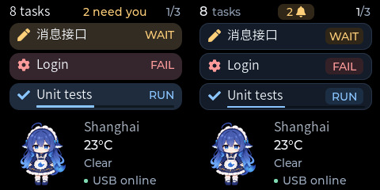

# Message surface and header polish

Date: 2026-11-06

Status: Implemented, desktop-tested, and firmware-built. Not flashed.

## Actual LVGL output

The left image is the previous layout; the right image is this revision. Both
are actual 240 x 240 LVGL renders, placed side by side without scaling. Weather
and task content are fixtures, not live observations.

## Styling

- The task count has a bright 16 px number and a muted 14 px unit. A compact
  amber badge shows the attention count followed by a small bell icon and
  disappears at zero. The bell uses the bundled Montserrat symbol glyph.
  Page position uses a bright current page and muted separator/total.
- All message surfaces use `#131c28`, a 1 px `#273446` border, and the existing
  12 px corner radius. State color appears in icons, status badges, and progress.
- Fixed-size 48 x 21 status badges center `RUN`, `WAIT`, `FAIL`, and `DONE`.
  Completed titles are muted; active and attention titles remain bright.
  Offline titles and badges use neutral colors and hide progress.
- Progress tracks are 2 px high with a subdued `#0a1018` background. Their
  positions remain reserved, so updates do not move titles or neighboring rows.
- Notification surfaces share the same neutral background and thin border.
  Their state text and task icon retain semantic accents.

The three-row geometry, pure-black outer background, persistent companion and
weather area, local animation, and rotation/notification behavior are preserved.
No host API or wire schema changes are needed.

## Other captured states

| State | Actual LVGL output |
| --- | --- |
| Three rows | [Overview](images/message-polish-overview.png) |
| Two rows, including completion | [Partial page](images/message-polish-two.png) |
| Single row, no attention/page badge | [One task](images/message-polish-one.png) |
| Waiting notification | [Notification](images/message-polish-notification.png) |
| Notification with progress | [Progress](images/message-polish-progress.png) |
| Disconnected | [Offline](images/message-polish-offline.png) |
| No tasks | [Empty](images/message-polish-empty.png) |
| Truncated long title | [Long title](images/message-polish-long.png) |

## Verification

All four native CTest checks pass. The existing screen checks cover visible
widget bounds, long-title truncation and recovery, sparse pages, progress values,
notifications, offline/empty states, and animation-only partial refreshes. The
captures confirm that message changes leave the persistent area unchanged.

The ESP-IDF v6.1 build passes. The application image is 869,408 bytes, leaving
17% of the 1 MiB application partition free.

Build and preview commands are documented in
[Companion UI validation](companion-ui-validation.md) and
[Local companion animation](companion-animation.md). Desktop rendering uses
RGB888; final RGB565 LCD colors and readability require physical review.
