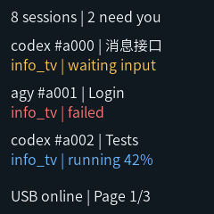
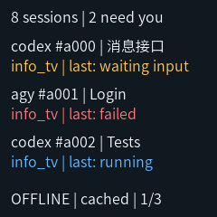
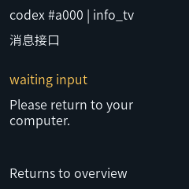

# Multi-conversation overview validation

Date: 2026-11-05

Scope: Desktop verification, an ESP32-S3 firmware build, and USB device feedback
after flashing on 2026-11-05. These images are CPU-rendered LVGL output rather than
photographs of the physical display. On the same date, the user confirmed that
physical text, layout, and page rotation were normal.
Earlier hardware evidence is retained in
[Hardware Validation](hardware-validation.md).

## Behavior

- Eight independent persistent conversation/task cards, three rows per page.
- Six-second page rotation; attention first, with all pages still visited.
- Source, conversation title, project, state, and optional reported progress.
- Stable conversation cards across executions, with increasing `run_sequence`;
  each execution keeps its own `task_id`, update sequence, and completion notice.
- Late execution updates cannot overwrite newer execution state; duplicate and
  conflicting event IDs retain the existing admission rules.
- Related notifications restore the page containing their card for a full interval.
- Per-row Presented feedback after the shared refresh, without claiming that
  hidden pages or superseded revisions were displayed.
- Cached offline state is labeled `last:` and does not show a live percentage.

## Checks

```powershell
cmake -S firmware/tests -B build/native-tests -DINFO_TV_BUILD_UI_TESTS=ON
cmake --build build/native-tests --config Debug
ctest --test-dir build/native-tests -C Debug -LE hardware --output-on-failure

cd host
uv run pytest
uv run ty check . ../scripts ../demos
uv run python ../scripts/protocol/generate_protocol.py --check
```

The optional screen test uses the LVGL dependency downloaded by the firmware
build; the default native core tests remain independent of LVGL. It checks widget
bounds, source/header content, long-to-short text replacement, row hiding,
and offline/empty/notification layout states. Portable pixel images
are written as `build/native-tests/screen-*.ppm`.

Results: 30 Python tests passed, including two real Python-to-C++ bridge tests;
four CTest cases passed with screen verification enabled; static analysis and
generated binding checks passed. The eight-conversation integration test waits
for later pages to receive their individual visibility acknowledgments.

The generated maximum envelope is 4029 bytes, within the unchanged 4096-byte
payload limit. Native codec tests round-trip an eight-card maximum-field snapshot.
The ESP-IDF v6.1 firmware build passed within the existing 1 MiB app partition.
The final binary is 682,768 bytes (35% partition space remains), SHA-256
`e11016545ae2c5c1076e7bfd2fbc8568bc842afb60309d9c02bc29624cacd7b4`.
Compiled Xtensa entry frames are 32 bytes for communication `dispatch` and
272 bytes for `poll` after moving/resetting large messages outside local stack
temporaries. These are static frame observations, not measured hardware stack
high-water marks.

## Actual LVGL output

Overview, at its native 240 × 240 resolution:



Powered but disconnected cached content:



Temporary related notification:



### Tip: Preview the firmware UI without flashing

Use the desktop screen test for quick layout reviews while editing the firmware
UI. It compiles the same [ScreenView](../firmware/main/ui/screen_view.cpp), LVGL
9.3 sources, and enabled font used by the device. The test runs without a window,
serial connection, or attached ESP32.

The rendering path is:

```text
Fixed RenderModel examples
  -> production ScreenView::initialize() / render()
  -> LVGL 240 x 240 virtual display, RGB888 full-frame buffer
  -> lv_refr_now()
  -> flush callback copies the rendered pixels
  -> binary P6 PPM image
```

The implementation is in [test_screen.cpp](../firmware/tests/test_screen.cpp),
with desktop configuration in [lv_conf.h](../firmware/tests/lv_conf.h).
The flush callback immediately calls `lv_display_flush_ready()`. The exporter
converts the buffer's BGR byte order to RGB when writing PPM.

From the repository root, after a firmware build has downloaded the locked LVGL
dependency, run:

```powershell
cmake -S firmware/tests -B build/native-tests -DINFO_TV_BUILD_UI_TESTS=ON
cmake --build build/native-tests --config Debug --target test_screen
ctest --test-dir build/native-tests -C Debug -R '^screen$' --output-on-failure
```

This creates `screen-overview.ppm`, `screen-offline.ppm`,
`screen-notification.ppm`, and `screen-empty.ppm` in `build/native-tests/`.
To preview another case, edit the fixed `RenderModel` examples in the screen
test, then rebuild and rerun it. Review images at their native 240 x 240 size;
the test also checks visible widget bounds and label contents.

PNG conversion is a separate export step. The images above were converted from
PPM to BMP with Python, then to PNG with Windows `System.Drawing`, without
resizing. For a shorter Windows-only export of the known P6 format produced by
this test, the following PowerShell snippet writes PNG directly:

```powershell
Add-Type -AssemblyName System.Drawing
$taskPpm = [IO.File]::ReadAllBytes((Resolve-Path 'build/native-tests/screen-overview.ppm').Path)
$taskHeaderSize = [Text.Encoding]::ASCII.GetByteCount("P6`n240 240`n255`n")
$taskPng = Join-Path (Get-Location).Path 'build/native-tests/screen-overview.png'
$taskBitmap = [Drawing.Bitmap]::new(240, 240)
try {
    for ($taskY = 0; $taskY -lt 240; $taskY++) {
        for ($taskX = 0; $taskX -lt 240; $taskX++) {
            $taskOffset = $taskHeaderSize + 3 * ($taskY * 240 + $taskX)
            $taskColor = [Drawing.Color]::FromArgb(
                $taskPpm[$taskOffset], $taskPpm[$taskOffset + 1], $taskPpm[$taskOffset + 2])
            $taskBitmap.SetPixel($taskX, $taskY, $taskColor)
        }
    }
    $taskBitmap.Save($taskPng, [Drawing.Imaging.ImageFormat]::Png)
} finally {
    $taskBitmap.Dispose()
}
```

This preview checks actual widget rendering, fonts, clipping, colors, and spacing
for the supplied examples. Its fixed inputs bypass the host, USB, FreeRTOS, and
page scheduler. The desktop uses RGB888 full-frame rendering; the device uses
RGB565 partial rendering with SPI/DMA. Panel color, brightness, refresh timing,
and live transitions still require physical validation.

## Remaining limits

Font update: The subset limitation below describes this historical validation.
The production firmware now uses the release-sourced Maple Mono font documented
in [font conversion and validation](font-conversion.md).

System labels remain English. The enabled LVGL Source Han Sans SC 16 px font is
a limited CJK subset; these screenshots establish the displayed example only,
not arbitrary Chinese coverage. A complete simplified-Chinese font remains work
for a separate asset pass.

Card deletion, automatic retention expiry, actual Codex/agy adapters, and the
general notification API are not implemented in this stage. Eight current cards
are retained until host restart; existing conversations can keep receiving new
executions at capacity. `demos/demo_conversations.py` submits simulated clients
through the real API for manual display checks.

The host and firmware were deployed together on 2026-11-05. Device Hello
advertises the required `max_cards >= 8`; the host reports older firmware
as incompatible instead of sending an oversized snapshot. Five simulated
conversations across two overview pages and both important notifications returned
actual device Presented feedback, establishing LCD refresh/DMA completion.
Separately, the user confirmed physical text, layout, and page rotation as normal.
This does not establish precise timing measurements or acknowledgment of each
individual notification. The eight-card maximum remains
covered by desktop tests; this device run submitted five cards.

See the [deployment and backup record](hardware-validation.md#6-multi-conversation-firmware-deployment).
