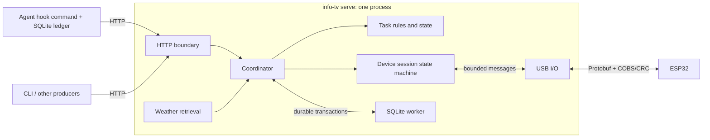

# Rust Host Architecture and Migration Design

Status: Architecture implemented; desktop checks passed. Hardware/login qualification remains pending.

Updated: 2026-11-07

## 1. Purpose and Decision Status

Replace the Python host with a Rust implementation distributed as a native
executable. The goals are installation without a user-managed Python environment,
efficient background operation, and concentrating future host development in one
implementation. Resource improvements must be measured rather than assumed.

The following product decisions are confirmed:

- Rust is the production host. The Python service and its tests have been
  removed with user approval; the reference remains in Git history and retained
  compatibility fixtures. Release qualification remains separately tracked.
- The host must restore current tasks and target brightness after restart.
- Automatic startup is required after user login; operation before login is not
  required.
- Configuration accepts an explicit path; otherwise, look for YAML configuration
  in the process's current working directory.
- The architecture was discussed before implementation; the user subsequently
  approved implementation of the plan.

The architecture and recovery policies below form the approved implementation
plan. Concrete implementation choices are recorded in Section 12. Test results
and physical validation are separate evidence, not implied by design approval.

Working assumptions are Windows-first delivery, one active display per service,
the existing loopback HTTP API, and the existing USB device protocol. Keep
platform-specific integration separate so other desktop platforms can follow.

## 2. Existing Contracts and Migration Scope

The historical Python implementation supplied the migration baseline. Relevant
contracts and evidence are recorded in:

- [Software architecture](architecture.md).
- [Device protocol](device-protocol.md) and [device.proto](../protocol/device.proto).
- [Host CLI](host-cli.md) and [YAML configuration](host-configuration.md).
- [Task lifecycle and automatic weather](host-lifecycle-weather.md).
- [Codex](codex-hooks.md), [agy](agy-hooks.md), and [ZCode](zcode-hooks.md) adapters.
- [Hardware validation](hardware-validation.md).

Migration includes the service, client CLI, all three hook adapters, automatic
weather, manual weather and alerts, brightness, serial discovery, reconnect
synchronization, and delivery feedback. Python may remain a developer dependency
for firmware tooling and optional HTTP demos; installed host users must not need it.

Preserve the HTTP routes, JSON fields, validation rules, status-code semantics,
YAML field precedence, UTF-8 byte limits, and Protobuf field numbers. Persistence
and default configuration discovery are intentional changes from the current
process-local state and explicit-config-only behavior described in older docs.
Do not change firmware behavior simply to accommodate the language migration.

Inventory CLI aliases, the separate `info-tv-hook` entry point, `/docs`, OpenAPI,
and validation error bodies before cutover. Their compatibility or replacement
must be explicit; a framework change does not preserve them automatically.

## 3. Process and Deployment Model

Ship one executable with service and short-lived client commands:

| Command | Function |
| --- | --- |
| `info-tv serve` | Start the persistent host service, HTTP API, and device connection. |
| `info-tv status` | Query service health, device connection, and delivery status. |
| `info-tv task ...` | Submit task events, list current tasks, or close a task card. |
| `info-tv weather ...` | Query, set, or clear weather; query automatic retrieval status. |
| `info-tv alert ...` | Query, set, or clear the current weather alert. |
| `info-tv brightness ...` | Query or set the target backlight brightness. |
| `info-tv ports` | List serial ports and identify device candidates without opening a connection. |
| `info-tv autostart ...` | Install, inspect, or remove per-user login startup explicitly. |
| `info-tv hook codex ...` | Convert Codex callbacks into task events, save them locally, and attempt delivery to the service. |
| `info-tv hook agy ...` | Convert agy callbacks into task events, save them locally, and attempt delivery to the service. |
| `info-tv hook zcode ...` | Convert ZCode callbacks into task events, save them locally, and attempt delivery to the service. |

Only `serve` remains running. Client commands use HTTP; only the service owns the
serial connection. Hook commands also access their local SQLite ledgers. Existing
hook configurations will need an explicit compatibility or reconfiguration path.

Run the service under the logged-in user's identity. Proposed Windows startup
uses a per-user Task Scheduler logon task, with absolute executable/config paths,
an explicit data directory, and no administrator requirement. Verify launch
without a persistent console window and clean behavior across logout and login.
Startup registration and removal should be explicit user operations; command
names and the window-hiding mechanism remain to be designed.

Prevent concurrent service instances for the same state directory with an OS-held
lock. Bind the configured loopback port before starting device work. A second
instance must report the conflict rather than access the same device/database.

Proposed Windows layout, retaining the existing `info_tv` data-directory name:

```text
<installation>/info-tv.exe
<configuration file: explicit path or ./info-tv.yaml>
%LOCALAPPDATA%/info_tv/host.sqlite3
%LOCALAPPDATA%/info_tv/codex-hooks.sqlite3
%LOCALAPPDATA%/info_tv/agy-hooks.sqlite3
%LOCALAPPDATA%/info_tv/zcode-hooks.sqlite3
%LOCALAPPDATA%/info_tv/logs/
```

Application state belongs outside the installation directory so replacing the
executable preserves it. User configuration is not rewritten when restoring
runtime state. Configuration discovery does not change the state-directory or
hook-ledger locations.

### 3.1. Configuration Discovery and Precedence

The proposed default filename is `info-tv.yaml`. Apply the following rules to
`serve` and `ports`:

| Invocation or condition | Behavior |
| --- | --- |
| `--config <path>` is supplied | Read exactly that file. Resolve a relative path against the process's current working directory. |
| No `--config` is supplied | Look for `info-tv.yaml` directly in the current working directory. |
| The default `info-tv.yaml` does not exist | Use built-in defaults, then apply explicit CLI overrides. |
| An explicitly selected file is missing or unreadable | Report a configuration error; do not fall back to another file or defaults. |
| A discovered file is unreadable, malformed, or fails validation | Report a configuration error; do not silently ignore it. |

The current working directory is the directory from which the process is
launched, not the directory containing the executable. Do not search parent
directories, the installation directory, or the user profile. Select at most one
YAML file; do not merge an explicit file with the discovered default file. An
explicit path may have any filename.

Field precedence remains: explicit CLI options, then the selected YAML file,
then built-in defaults. Read configuration once at startup; changes require a
restart. Retain the existing strict field/type validation, including rejection
of empty files, unknown fields, and invalid ranges. An empty mapping (`{}`) is
valid and uses defaults.

```powershell
# Read .\info-tv.yaml if present; otherwise use defaults.
info-tv serve

# Read a specific file, ignoring .\info-tv.yaml.
info-tv serve --config C:\info-tv\settings.yaml

# Read a relative file and override its serial-port setting.
info-tv serve --config .\config\display.yaml --serial-port COM6
```

Log the resolved configuration path, or that defaults are in use, for `serve`.
For `ports`, keep diagnostics on stderr so stdout remains machine-readable.
HTTP client and hook commands retain their own explicit connection options;
they do not load server YAML from an agent's project directory.

When registering login startup with a selected configuration file, save its
resolved absolute path in the launch arguments. Always set an explicit working
directory for the startup task, including when using defaults, so discovery
does not depend on Task Scheduler's working-directory defaults.

## 4. Components and Dependencies



Start with one Cargo package containing a library, executable, and integration
tests. Logical modules do not require separate crates or processes.

| Module | Responsibility and boundary |
| --- | --- |
| `tasks` | Domain types, event ordering, deduplication, task admission, closure, and retention; independent of HTTP and generated Protobuf types. |
| `views` | Convert domain state into source-independent cards and notifications. |
| `device` | Handshake, synchronization, command scheduling, retry, heartbeat, and feedback correlation. |
| `protocol` | Generated Protobuf types, frame encoding/decoding, and wire validation. |
| `transport` | Serial discovery, open/read/write/close, and byte-stream errors. |
| `http` | Request validation, coordinator requests, and HTTP responses. |
| `hooks` | Source-specific callback parsing, execution correlation, SQLite ledger, and delivery attempts. |
| `weather` | Provider retrieval, validation, freshness, and domain conversion. |
| `storage` | Versioned host schema, transactions, loading, and migrations; no HTTP or serial operations. |
| `config` | Startup configuration parsing and validation. |
| `runtime` | Composition, coordinator loop, background-task supervision, and shutdown. |
| `cli` | Command parsing and dispatch to service, clients, or hooks. |

Use concrete modules and small data types. Introduce an interface where there is
a real alternative, such as serial versus simulated transport. Do not introduce
a general plugin framework, event bus, or repository interface for every type.

## 5. Concurrency and State Ownership

One coordinator task exclusively owns task state and device-session state.
These remain separate modules, called by the coordinator. HTTP requests, weather
results, transport events, and timer expirations enter through explicit messages.
Queries also use the coordinator initially, avoiding a second authoritative cache.

| Owner | Mutable state or resource |
| --- | --- |
| Coordinator / task module | Current cards, ordering records, deduplication, retired identities, completion deadlines. |
| Coordinator / device module | Connection state, coalesced updates, notification queue, pending command, and feedback. |
| USB I/O task | Serial handle, byte reads/writes, and connection generation. |
| SQLite worker | Host database connection and transaction execution; no business decisions. |
| Weather task | In-flight provider request; accepted weather belongs to the coordinator. |
| Each hook process | Its database connection and bounded-duration HTTP attempt. |

Use bounded in-memory channels with request/reply messages. Admission messages
are not successful merely because they entered a channel. Bound HTTP concurrency
and body sizes as well, so waiting requests do not create an implicit unbounded
queue. Feedback must continue to receive processing under producer load.

Keep blocking database work and serial enumeration outside the asynchronous
executor's event loop. During a durable commit the coordinator serializes business
mutations; I/O can continue, but feedback processing may wait. Keep transactions
short and test storage latency against heartbeat deadlines. Do not promise that
a stalled disk leaves device liveness unaffected.

Drive work from messages, I/O readiness, and the next actual deadline. Retain
required heartbeats and reconnect timers without copying short polling loops.
Tag transport events with a connection generation so delayed events from a closed
connection cannot update its replacement.

## 6. Durable Admission and Storage

Proposed acceptance rule: acknowledge a state-changing operation only after its
durable transaction commits. Apply this to tasks, closure, target brightness,
manual weather/alerts, and accepted automatic weather. Device presentation remains
asynchronous and is not part of the transaction.

For a task event:

1. Validate the HTTP request and translate it into a domain event.
2. Evaluate duplicate/stale/closed/conflicting outcomes and task capacity.
3. Check notification capacity before changing business state.
4. Prepare the task, ordering, deduplication, and notification-eligibility changes.
5. Commit the durable changes in one SQLite transaction.
6. Publish the prepared in-memory state and delivery work, then return the result.

The coordinator must not interleave another business mutation between preparation
and publication. A failed transaction leaves the previous accepted state intact
and produces no delivery work. Report storage failure rather than accepting an
in-memory-only update. Database work must not include waiting for the device.

If the process exits after commit but before the response, a retry with the same
event ID and unchanged payload is recognized after restart. Persist ordering and
deduplication metadata together with cards; saving only display content is
insufficient. Protection remains bounded, matching documented cache eviction.

Start with SQLite transactions and explicit durability settings suitable for
committed-state recovery. Do not defer all saves until graceful exit or use a
periodic snapshot as the acknowledgment boundary. Final journal/synchronization
settings require implementation validation on supported storage.

Version the schema and perform upgrades transactionally before serving requests.
An unsupported newer schema or unreadable database must report an error, not
silently initialize empty state. Keep host storage separate from hook ledgers.

## 7. What Survives Restart

The following is the proposed interpretation of the confirmed recovery requirement:

| Data | Recovery policy |
| --- | --- |
| Current tasks | Restore business fields, card IDs, revisions, execution ordering, and notification-transition markers. |
| Completed/interrupted retention | Restore the original completion time and preserve elapsed downtime; retries do not reset retention. |
| Retired cards and recent event identities | Restore bounded records so closed runs stay closed and recent retries remain idempotent. |
| Target brightness | Restore the last accepted target, including zero; use the default only when no target has been saved. |
| Weather | Restore values and original expiry; stale data must not become fresh. |
| Weather alert | Restore identity, sequence, original submission comparison data, and expiry; synchronize the marker without replaying its notification. |
| Service session and in-flight commands | Create a fresh session and new commands. Do not resume old message IDs or transport buffers. |
| Accepted/Presented/Applied feedback | Start as pending or unknown and obtain new-session feedback. Old results do not prove current display or hardware state. |
| Notification queue | Do not replay historical notifications after restart; preserve transition markers to prevent retry-triggered duplicates. |

This proposal makes task state durable, but does not guarantee notification
presentation across a process failure. A crash after admission and before sending
may lose a transient notice; the restored task still appears in the overview.
Reliable notification replay would require a separate policy and is not proposed.

Persist UTC timestamps for cross-process deadlines and use monotonic deadlines
inside a running process. Reconstruct only the remaining lifetime after restart.
Do not serialize a process-local monotonic clock or restart a full validity window.
Clock changes, suspend/resume, and retention-setting changes need explicit tests
and a final policy; invalid time data must not silently renew weather validity.

Restoring a `running` task does not prove that its producer is still executing.
Retain the last accepted business state; silence or restart alone does not invent
a completion, failure, or new run. A future stale-task UX is a separate feature.

## 8. Startup, Reconnection, and Shutdown

Proposed startup sequence:

1. Resolve configuration using Section 3.1 and validate it before device/network work.
2. Acquire the state-directory instance lock, open/migrate storage, and load state.
3. Retire tasks whose retention elapsed and evaluate weather/alert expiry.
4. Create a fresh service session and initialize delivery status as pending.
5. Bind loopback HTTP, then start device discovery and optional weather retrieval.
6. Exchange Hello and verify the existing firmware capabilities.
7. Synchronize the authoritative task/weather snapshot and wait for Accepted.
8. Reapply target brightness and wait for Applied before reporting online.
9. Synchronize an unexpired alert marker without replaying its notification.

Absent or ambiguous devices keep the service offline while HTTP remains available.
Rediscover ports on reconnect. A device reconnect within the same host process
resynchronizes current state using the existing protocol rules. Host restart uses
a new session even if the device stayed powered.

Keep card updates coalesced, notifications independent, and command retries tied
to their original identities within a connection. Preserve the current one-command
acknowledgment window and fairness between card updates and notices. Never extend
freshness when retrying or synchronizing.

Expected USB failures trigger reconnect. Weather failures retain existing values
without extending validity. Unexpected core-task failures must reach the runtime
supervisor and produce diagnostics and a controlled failure rather than leave a
healthy-looking API with stopped delivery.

Shutdown stops admission, resolves already-started durable transactions, cancels
retrieval/device work, closes the serial handle, and awaits workers before exit.
Accepted-state survival must also work after forced termination. Startup and
shutdown must not require the device or weather provider to be available.

## 9. Hook Capture and Delivery

Keep one source adapter per native callback format. A hook command should:

1. Parse the callback and identify its conversation/execution.
2. In one SQLite transaction, update its ordering ledger and enqueue an immutable
   task event with a stable event ID.
3. Attempt delivery to loopback HTTP within a short time budget.
4. Delete the exact queued event only after a valid admission acknowledgment.

Do not keep a database write transaction open across HTTP. Concurrent callbacks
must serialize ledger transitions; concurrent sends can repeat the same event,
which the host deduplicates. Preserve per-source identity rules and known native
limitations rather than guessing missing turn identities.

Preserve existing non-blocking-agent behavior: runtime delivery failures remain
queued and produce diagnostics without returning a policy rejection to the agent.
Retain explicit flush behavior. Without another callback or flush, a saved event
need not be delivered immediately when the service starts; automatic background
draining is not part of the current proposal.

Prefer compatibility with existing ledger paths and schemas, verified against
realistic fixtures. If conversion is necessary, specify and test it before
cutover. Avoid simultaneous old/new writers during a schema conversion.

## 10. Candidate Libraries and Build Boundary

These are candidates, not pinned dependency decisions:

| Concern | Candidate |
| --- | --- |
| Asynchronous execution and channels | [Tokio](https://tokio.rs/tokio/tutorial/channels) |
| Local HTTP server | [Axum](https://docs.rs/axum/latest/axum/) |
| Protobuf | [Prost](https://docs.rs/prost/latest/prost/) |
| Asynchronous serial I/O | [tokio-serial](https://docs.rs/tokio-serial/latest/tokio_serial/) |
| HTTP client | [Reqwest](https://docs.rs/reqwest/latest/reqwest/) |
| CLI parsing | [Clap](https://docs.rs/clap/latest/clap/) |
| SQLite access | [rusqlite](https://docs.rs/rusqlite/latest/rusqlite/) |

Select maintained serialization, YAML, and logging dependencies during detailed
design. Preserve strict YAML types and hexadecimal USB IDs. Weather clients must
retain required proxy/SOCKS support; loopback clients must bypass environment
proxies. Bundle SQLite and required runtime components in release artifacts.

Generate Rust bindings from the shared schema and verify consistency in CI.
Protobuf generation tools are build/development dependencies, never installation
requirements for release users. Decide checked-in bindings versus build-time
generation when updating the existing generation workflow. Pin resolved Rust
dependencies and publish artifacts per supported OS/architecture.

Before committing to serial integration, validate Windows unplug/replug,
cancellation, handle closure, port renumbering, and DTR/RTS behavior. Measure idle
memory/CPU, wakeups, hook startup time, and event bursts in optimized builds.
Choose runtime worker counts from evidence rather than assuming that more
threads or a particular memory target is necessary.

## 11. Migration and Acceptance

The proposed implementation order is:

1. Inventory contracts and reusable fixtures; record Python resource baselines.
2. Implement domain rules, protocol/framing, and transactional persistence.
3. Implement simulated transport, coordinator, HTTP, and device recovery.
4. Complete CLI, hooks, configuration, and weather parity.
5. Validate physical hardware, user-logon startup, and clean-machine distribution.
6. Switch the default installation guide and future feature work to Rust.

Run Python and Rust alternatives separately against a device. Normalize random
IDs and timestamps when comparing observable behavior. Existing Python in-memory
tasks cannot be recovered retroactively; recovery starts with Rust-persisted
state. Existing hook ledgers require their own compatibility checks.

| Area | Required evidence before default cutover |
| --- | --- |
| Contracts | Existing routes, CLI/config behavior, text bounds, and admission outcomes verified against the migration inventory. |
| Config discovery | Explicit/relative paths, working-directory lookup, missing-default fallback, invalid-file errors, and CLI precedence pass; client/hook commands do not load server YAML. |
| Domain | Duplicate/conflicting IDs, stale sequences, conversation runs, capacity, closure, and retention remain correct. |
| Durability | Normal restart and forced termination recover accepted tasks/brightness; commit-before-response retries are idempotent. |
| Storage failure | Failed writes do not acknowledge new state, mutate the accepted cache, or publish device work. |
| Recovery | Expired tasks stay retired, stale weather stays stale, old notices are not replayed, and delivery feedback is freshly obtained. |
| Protocol | Compatibility vectors, bounded framing, and the native firmware bridge pass without schema drift. |
| Load | Concurrent submissions, full queues, slow storage, and device feedback remain bounded and have explicit outcomes. |
| Hooks | Service-down capture, concurrent callbacks, immutable retries, ledger upgrade, and flush behavior pass. |
| Hardware | Handshake, brightness, display feedback, powered host restart, and USB reconnect verified on the board. |
| Distribution | A clean Windows user can run the release without Python and retain state across binary replacement. |
| Login lifecycle | Startup under the correct user, duplicate launch, paths containing spaces, logout/login, and autostart removal verified. |
| Resources | Optimized Rust results compared with Python under equivalent idle, disconnected, and event-load conditions. |

## 12. Implementation Decisions

- The package lives in `host-rust/`. Python service sources, tests, packaging,
  and bindings have been removed. `scripts/` owns the locked Python development
  tools for Nanopb generation; Cargo generates Rust bindings independently.
- Schema version 1 stores the bounded business snapshot as JSON in one SQLite
  row. A dedicated worker commits it with WAL and `synchronous=FULL`; queries
  use coordinator-owned state. This avoids a second normalized business model.
- Runtime time never moves backward. Elapsed monotonic time and observed UTC
  advance expiry, including time spent suspended. If UTC at restart predates the
  last saved timestamp, timed weather/alerts and terminal cards expire
  conservatively. Running/waiting/failed cards remain. Changing retention applies
  the new duration to the original saved completion timestamp, without resetting it.
- `autostart install/status/remove` manage a limited-privilege Windows logon task.
  Its hidden PowerShell launcher keeps absolute paths and waits for the service.
  Installation is explicit and does not modify startup during a normal launch.
- Both `info-tv hook <source>` and the `info-tv-hook <source>` compatibility binary
  use the same adapter code and existing ledger schemas. Source flags and stored
  event UUIDs remain compatible; executable paths still need to be updated.
- `/openapi.json` embeds the Python contract and `/docs` presents it through
  Swagger UI. Validation keeps status 422 and a `detail` array; diagnostic messages
  and field-location granularity differ from Pydantic. Domain errors retain their
  status and string `detail`. Requests are bounded to 16 KiB, with 64 active
  handlers and a 15-second request deadline. A timed-out mutation may still commit;
  clients must retry with the unchanged event identity.
- `build.rs` generates bindings directly from the shared schema with build-only
  vendored protoc. Cargo.lock pins dependencies. Reqwest supports SOCKS for
  weather; local clients bypass proxies and automatic redirects.
- The first packaged release target is Windows x86-64 MSVC. The packaging script
  links the MSVC runtime statically and bundles both executables and example YAML.
  Publishing, clean-machine qualification, physical USB/display checks, and actual
  logout/login validation must be recorded separately.

See the [Rust host guide](../host-rust/README.md) for commands and the
[validation record](rust-host-validation.md) for completed checks and remaining
qualification. Do not treat desktop bridge feedback as physical display validation.
