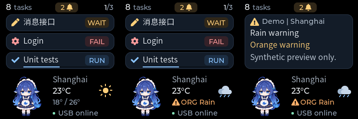

# Weather icons, daily range, and hazard alerts

Date: 2026-11-06

Status: Implemented, desktop-tested, firmware-built, and flashed on 2026-11-06.
Five demo cards and a TEST alert notification returned actual device Presented
feedback; visual confirmation remains pending. See the
[deployment record](hardware-validation.md#7-companion-weather-and-alert-firmware-deployment). Weather
and alerts remain producer-supplied; no provider or automatic city detection is
configured. All screenshots use synthetic fixtures, not actual warnings.

The subsequent [header connection revision](header-connection-ui.md) moves USB
status to the top bar, omits redundant condition names, and places the daily
range/freshness and warnings on separate lines. The captures below preserve the
original weather layout.

## Actual LVGL output

Left to right: ordinary weather, persistent alert, and important notification.
Each panel is the actual 240 x 240 LVGL output without scaling.



The current temperature occupies an 86 px label. A locally drawn 32 x 29 weather
icon sits at (196, 169), using LVGL rounded shapes and strokes without downloaded
images or emoji fonts. The symbol catalog matches the existing condition enum:

| Unknown | Clear | Cloudy | Rain | Snow | Storm | Fog |
| --- | --- | --- | --- | --- | --- | --- |
| [Preview](images/weather-0.png) | [Preview](images/weather-1.png) | [Preview](images/weather-2.png) | [Preview](images/weather-3.png) | [Preview](images/weather-4.png) | [Preview](images/weather-5.png) | [Preview](images/weather-6.png) |

The supplemental line has this precedence: active alert, stale observation,
daily low/high, condition text. Missing weather shows `Not set` without an icon;
stale weather retains a neutral-colored icon and dimmed temperature. Without
weather, an active alert can still show its location and marker. The extreme
supported range also [fits the label](images/weather-extreme.png).

An alert replaces that one line with a warning symbol, severity abbreviation
(`BLU`, `YLW`, `ORG`, `RED`), and bounded title. Color accompanies text rather
than carrying severity alone. Longer labels truncate. The notification shows
source/location, title, severity, and detail in the existing bounded lines; full
text remains available through HTTP. Its [dedicated preview](images/weather-notification.png)
uses short metadata so both source and location are visible.

Messages, task counts, page rotation, character motion, and USB state retain
their existing roles. Alerts do not create task cards or increment task attention
counts. Sunrise/sunset rotation, day/night variants, and forecast pages are not
included in this revision.

## Producer API

`PUT /v1/weather` retains its existing fields and accepts optional paired integer
`daily_low_c` / `daily_high_c`, each in -100..100. Supply both or neither; the low
must not exceed the high. Omission or two nulls clears a previous range. Boolean,
string, fractional, incomplete, and reversed ranges receive HTTP 422.

```json
{
  "location": "Shanghai",
  "temperature_c": 23,
  "condition": "clear",
  "daily_low_c": 18,
  "daily_high_c": 26,
  "valid_for_seconds": 1800
}
```

`PUT /v1/weather/alert` selects one current alert independently of weather:

```json
{
  "alert_id": "080ba71e-5bb0-4181-b202-fb75de310173",
  "sequence": 1,
  "title": "Rain",
  "source": "Demo",
  "location": "Shanghai",
  "severity": "orange",
  "detail": "Synthetic preview only.",
  "valid_for_seconds": 3600
}
```

The producer selects an alert relevant to this display's location; the service
does not aggregate multiple alerts or infer severity from ordinary conditions.
Severity is the supplied `blue`, `yellow`, `orange`, or `red` label, ordered in
that sequence. There is no automatic translation of another provider's scale.
Use the publisher's actual source, location, severity, and remaining validity
after accounting for observation age. Title/source support 64 UTF-8 bytes,
location 24, and detail 160. Labels must be printable and required labels
nonblank. Validity is an integer in 1..86400 seconds.

An alert UUID identifies one issuance; positive `sequence` orders its updates.
Identical current-ID/sequence/content retries do not renew expiry or replay a
notification. Older or conflicting current-ID revisions receive HTTP 409.
Higher revisions replace complete state. A different UUID replaces the slot;
the producer is responsible for choosing the current issuance. No historical
ordering across different UUIDs is retained.

`GET /v1/weather/alert` returns `unavailable`, `active`, or `expired`, retained
metadata, source sequence, remaining `valid_for_ms`, notification disposition,
and delivery. `DELETE /v1/weather/alert` explicitly withdraws the marker and its
queued or active weather notification. Ordinary weather deletion does not clear
an alert. `GET /v1/device` includes `weather_alert`; weather GET responses also
include the optional daily range. PUT/DELETE return HTTP 202 for host admission;
a failed coordinator returns HTTP 503. State is process-local, without disk/NVS
persistence.

## Notification and expiry rules

- First issuance, a changed UUID, or a severity increase queues an important
  notification when online. Ordinary revisions and severity decreases update the
  marker without replay. A higher revision after expiry is a renewed issuance.
- Unsent updates coalesce, preserving a pending notification trigger. Offline
  admission and reconnect restore only still-valid markers, without popup history.
  Expired alerts are never revived by synchronization.
- The firmware reserves one weather notification slot in addition to eight task
  notification slots. Weather precedes queued task notices at equal priority.
  An active important notice finishes first; an ordinary one can be interrupted.
- A weather notification must start within the smaller of 30 seconds and the
  alert's remaining lifetime. Its ten-second visible duration starts at actual
  refresh completion. Dismissal restores tasks and retains the valid marker.
- Replacement by another issuance, severity change, explicit withdrawal, or
  expiry removes obsolete queued/active weather notices. Alert expiry also ends
  a visible weather notification early. Routine same-severity updates preserve
  the current notice instead of restarting it.
- Alert and observation deadlines are independent. A stale/cleared observation
  cannot erase a valid warning. Device timers continue offline and at zero
  brightness. Retries preserve operation identity and decrease remaining validity.

Delivery `accepted` means device UI admission. `notification_presented` means a
notification actually reached first-refresh completion; it is not independent
confirmation that the persistent weather marker was displayed. Silent updates
and clears have no notification Presented milestone.

## Wire and verification

The new required capability is `Hello.weather_details` (6). Weather gains optional
`daily_low_c` (5) and `daily_high_c` (6), using signed 8-bit Nanopb storage.
`Envelope.weather_alert` (20) carries a complete `WeatherAlert` or an entirely
empty explicit clear. Alerts are synchronized as a separate command after the
snapshot/brightness handshake and before ordinary online traffic. A new service
session clears the previous alert. Existing field numbers and version 1 remain
unchanged; host and firmware must be updated together.

The generated maximum envelope size is 4093 bytes, within the 4096-byte limit.
Native tests round-trip an eight-card maximum-content snapshot including both
daily extremes. Alert payloads remain separate from that snapshot.

Verification passed: 94 host tests including two Python-to-C++ bridge scenarios,
`ty`, generated-binding consistency, and all four native CTest targets. Regression
checks cover invalid ranges/alerts, sequence conflicts, duplicate TTLs, upgrade
notification, decreasing retry validity, silent recovery, expiry/withdrawal,
reserved queue capacity, warning order, widget bounds, and animation isolation.
The existing desktop LVGL exporter writes `screen-weather-*.ppm` for the images
above; its general workflow is described in
[the preview tip](multi-conversation-validation.md#tip-preview-the-firmware-ui-without-flashing).

ESP-IDF v6.1 builds `info_tv.bin` at 872,624 bytes, with 17% application-partition
space free. SHA-256:
`9B3EBBCA825962B7FB055668C1C3581609B8DE2DF4ECE19AC921A7E04A40618C`.
Physical RGB565 colors, readability, animation, and alert behavior remain to be
reviewed on the device.
